# 闹闹能量改造3000层哈吉米核心+999韩信

来源：https://www.bilibili.com/video/BV1gvhD6gEHu/?p=1

分析状态：completed

完整文字稿：../../../raw/BV1gvhD6gEHu_p1.md

## 00:37–01:13 日落海围绕能量改造，河洛围绕另一条天赋路线。

- 事件 ID：BV1gvhD6gEHu:p1:e001
- 场景：实战
- 时机：选择阵营时
- 背景（分析推断）：开局先确定阵营对应的成长方向。
- 学习目标（分析推断）：将阵营选择与后续关键天赋联系起来。
- 模板：opening-plan
- ASR 段落：[2]

> 选日落海,日落海就是去玩那个啥,去玩能量改造。

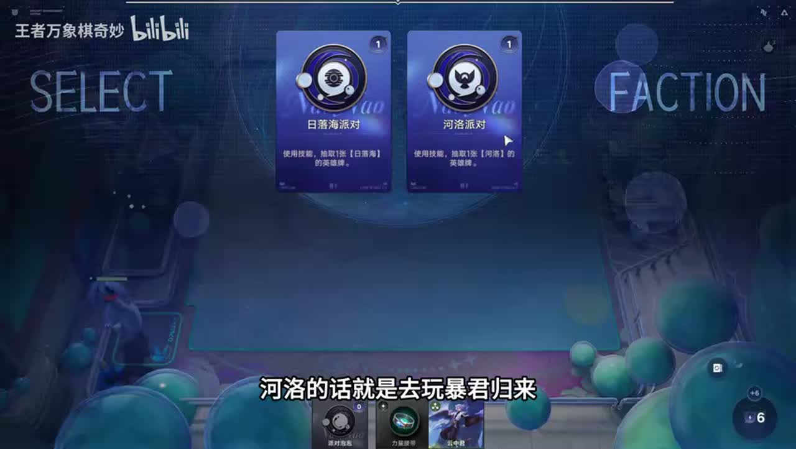

## 02:43–03:51 先检查核心已有层数和等级阶段，太早拿可能收益不足。

- 事件 ID：BV1gvhD6gEHu:p1:e002
- 场景：实战
- 时机：考虑早拿能量改造时
- 背景（分析推断）：讲者强调六级且核心已有积累；具体门槛存在ASR疑词。
- 学习目标（分析推断）：判断天赋启动条件而非看到就点。
- 模板：talent-fit
- ASR 段落：[5, 6]

> 六级赌,来得早还不行

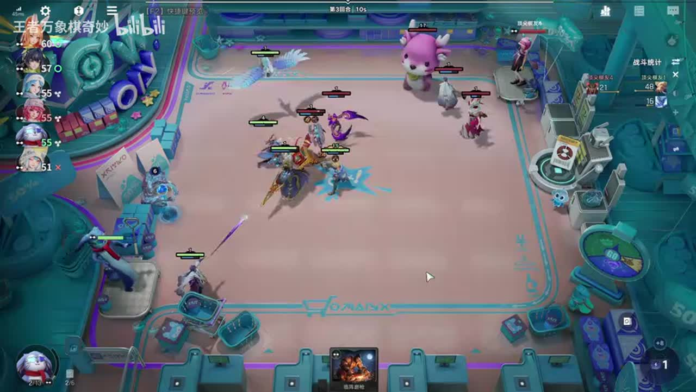

## 03:52–04:31 不要过快暴露竞价意愿，避免被持续抬价。

- 事件 ID：BV1gvhD6gEHu:p1:e003
- 场景：实战
- 时机：拍卖安琪拉时
- 背景（分析推断）：当前需要安琪拉，但竞价行为也会影响对手。
- 学习目标（分析推断）：认识拍卖信息与预算之间的关系。
- 模板：auction-choice
- ASR 段落：[7]

> 你顶的那么快别人看你想要

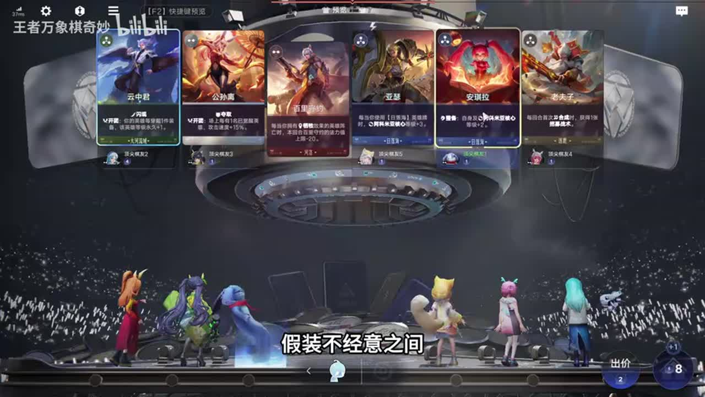

## 04:32–05:48 商店受领取天赋限制；可以承受不买时等核心成长后再领取。

- 事件 ID：BV1gvhD6gEHu:p1:e004
- 场景：实战
- 时机：领取天赋前
- 背景（分析推断）：讲者回答不领能否开商店，提出等待一两轮的代价。
- 学习目标（分析推断）：比较即时买牌机会与天赋启动收益。
- 模板：resource-order
- ASR 段落：[8, 9]

> 你的这个核心等级稍微高一点,然后再点啊。

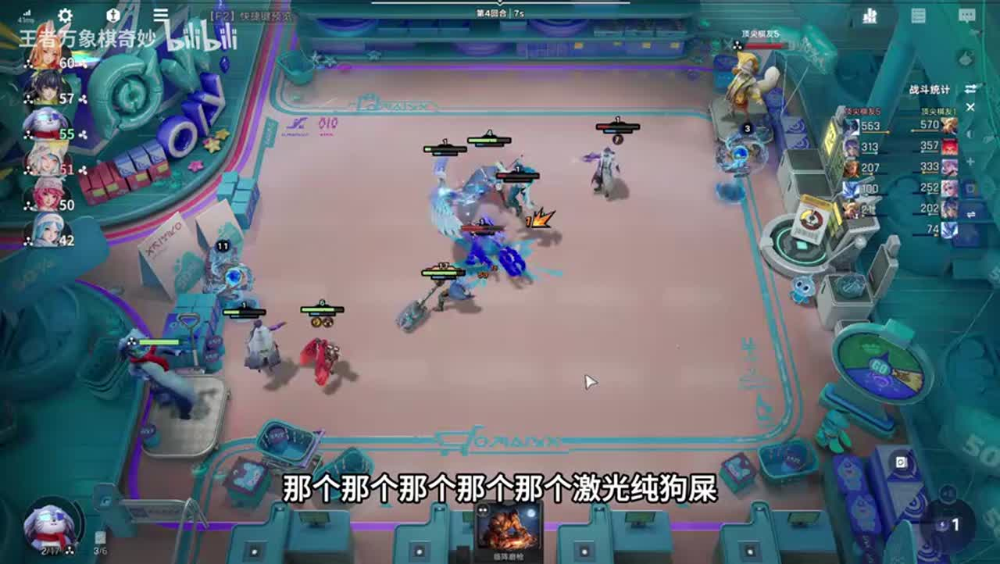

## 07:32–08:08 先把希望成长的韩信上场，再触发支撑。

- 事件 ID：BV1gvhD6gEHu:p1:e005
- 场景：实战
- 时机：准备触发亚连时
- 背景（分析推断）：当前目标还未就位，立即触发会浪费指向。
- 学习目标（分析推断）：按目标上场与成长触发的顺序操作。
- 模板：resource-order
- ASR 段落：[13]

> 我上寒心了之后我再触发。

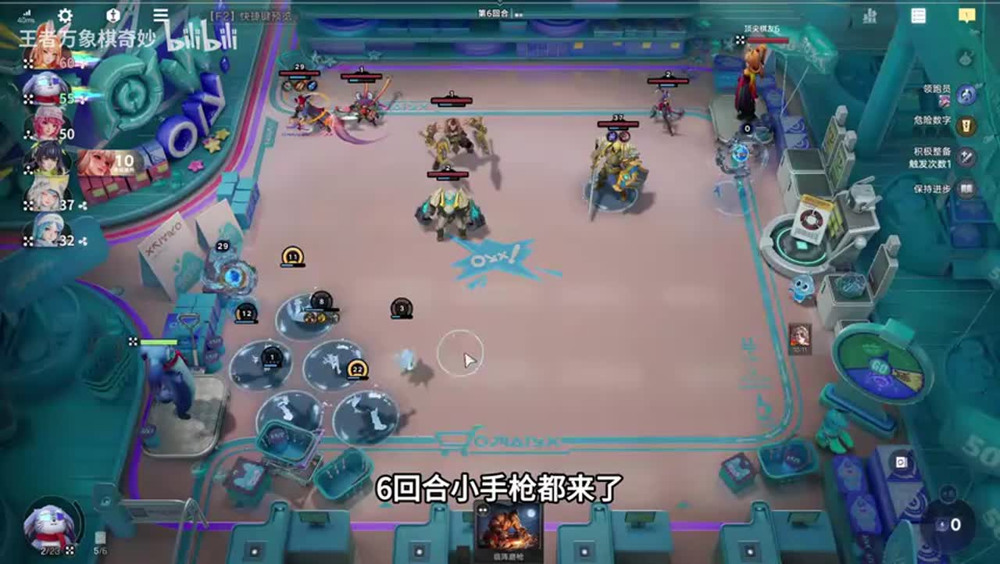

## 08:47–09:30 按讲者所述到五级再搜，四级只接受免费来牌。

- 事件 ID：BV1gvhD6gEHu:p1:e006
- 场景：实战
- 时机：准备搜索雅典娜时
- 背景（分析推断）：该阶段技能使用与商店搜索条件影响寻找成本。
- 学习目标（分析推断）：区分顺手留牌和主动投入搜索。
- 模板：level-transition
- ASR 段落：[15]

> 他白给就上,不白给拉倒

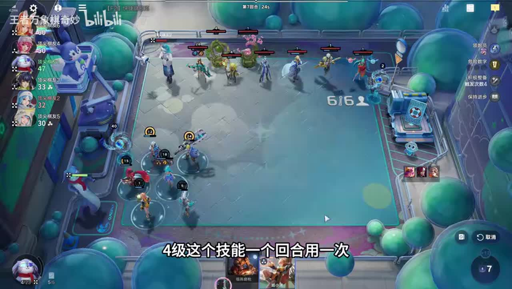

## 10:07–10:42 买不起时停止竞价，转回已有成长计划。

- 事件 ID：BV1gvhD6gEHu:p1:e007
- 场景：实战
- 时机：露娜竞价过贵时
- 背景（分析推断）：讲者在韩信与露娜之间选择，暂时无力承担高价。
- 学习目标（分析推断）：保留预算而非被关键牌诱导无限追价。
- 模板：auction-choice
- ASR 段落：[17]

> 太贵了,买不起。我一会儿自动发一个。

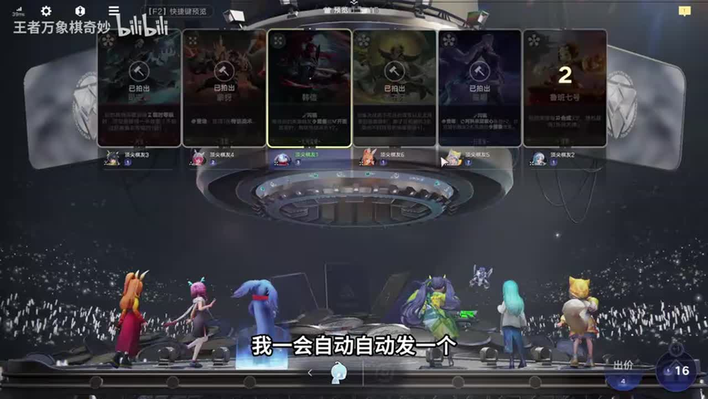

## 10:42–16:40 主核带最多装备，其余单位各带一件，以控制成长对象。

- 事件 ID：BV1gvhD6gEHu:p1:e008
- 场景：实战
- 时机：用亚连给主核升级时
- 背景（分析推断）：亚连按装备数量选择受益单位，装备分配不仅影响战力。
- 学习目标（分析推断）：利用装备数量控制支撑目标。
- 模板：position-binding
- ASR 段落：[18, 26]

> 这样的话让寒天尊去吃这个鸭脸。

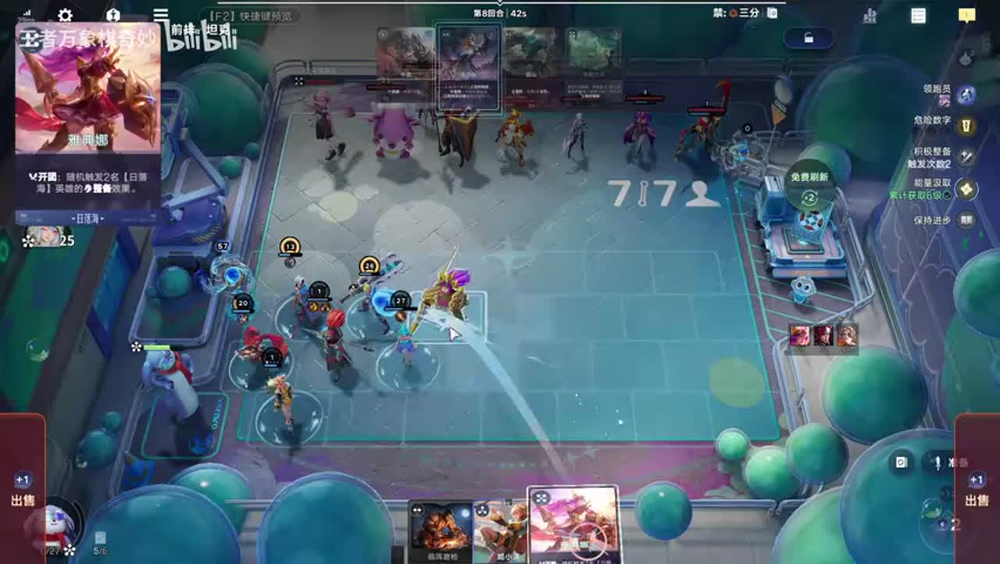

## 11:22–13:13 先保留成长候选，能量改造或智能装甲到来后再决定去留。

- 事件 ID：BV1gvhD6gEHu:p1:e009
- 场景：实战
- 时机：尚未拿到核心天赋时
- 背景（分析推断）：韩信与米莱迪暂时比较成长收益，路线未锁定。
- 学习目标（分析推断）：依据实际天赋重评阵容，避免过早承诺。
- 模板：fallback-plan
- ASR 段落：[19, 20, 21]

> 先养一会儿,如果有能量改造就留下来

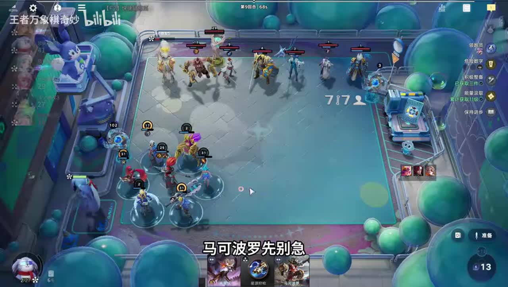

## 13:14–13:55 核心层数提高额外触发次数，海诺提供额外核心成长，不能轻易卖。

- 事件 ID：BV1gvhD6gEHu:p1:e010
- 场景：实战
- 时机：解释核心循环时
- 背景（分析推断）：讲者解释为何一个辅助单位值得保留。
- 学习目标（分析推断）：识别成长循环中的关键节点。
- 模板：growth-combo
- ASR 段落：[22]

> 每次升级的时候海诺都能额外哈基米合金再升一级

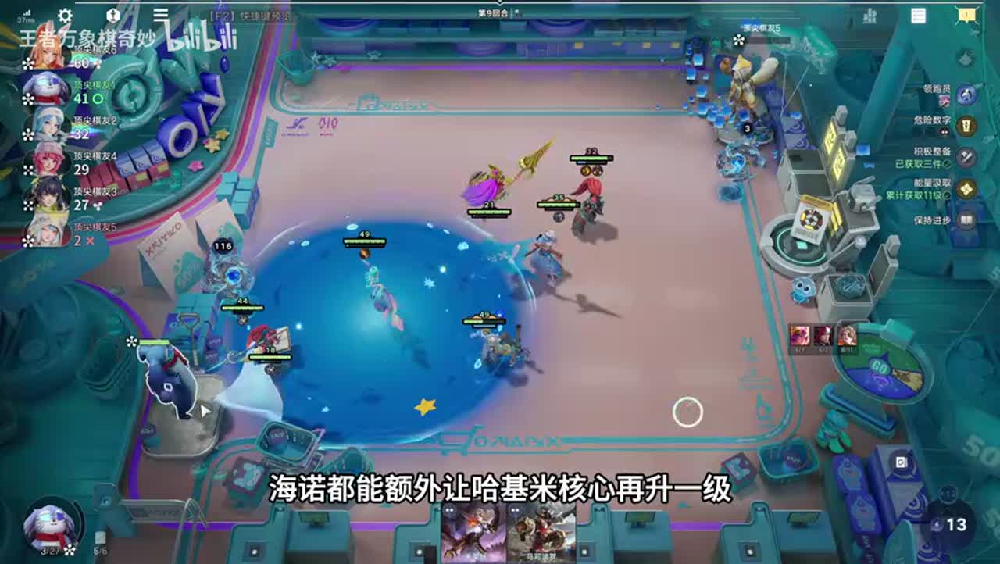

## 16:43–18:24 比较明刀保命与找露娜加速，先让安琪拉撑住；高价找牌需看库存。

- 事件 ID：BV1gvhD6gEHu:p1:e011
- 场景：实战
- 时机：成长启动前有死亡风险时
- 背景（分析推断）：讲者认为只差几轮，但这属于当时预测而非胜利保证。
- 学习目标（分析推断）：将生存预算和启动资源一起评估。
- 模板：economy-budget
- ASR 段落：[27, 28, 29]

> 一根明刀只是保一条命

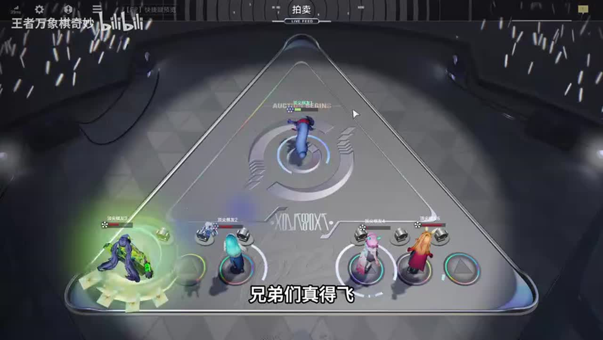

## 18:25–21:02 露娜能重复触发整备，保留双次整备单位并减少无效目标。

- 事件 ID：BV1gvhD6gEHu:p1:e012
- 场景：实战
- 时机：拿到露娜后整合支撑时
- 背景（分析推断）：讲者比较单次随机触发与露娜带来的重复触发。
- 学习目标（分析推断）：理解有效触发次数和场上目标数量。
- 模板：growth-combo
- ASR 段落：[30, 31, 33]

> 雅典娜能触发两个呀?

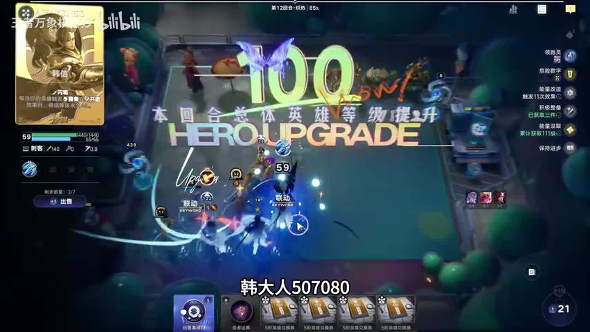

## 19:48–21:40 检查朵莉亚觉醒和合成是否遗漏，再补集体唤醒。

- 事件 ID：BV1gvhD6gEHu:p1:e013
- 场景：实战
- 时机：成长低于预期时
- 背景（分析推断）：讲者发现未觉醒、忘合成；夸张的亏损数不计入数据。
- 学习目标（分析推断）：用遗漏检查解释成长不足。
- 模板：combat-review
- ASR 段落：[32, 34]

> 老头忘打合成了

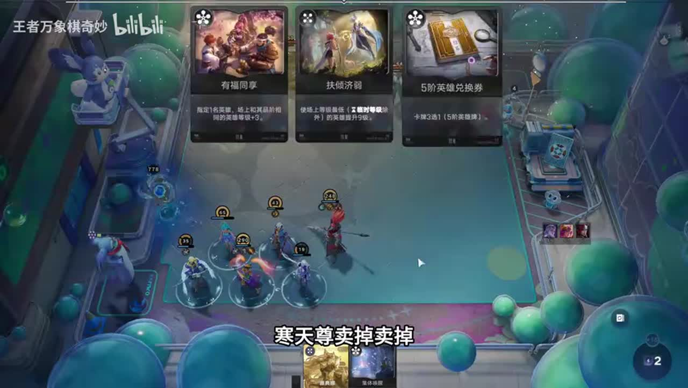

## 23:32–24:38 减少向即将满级单位继续投资源，提前准备传承与后期候选。

- 事件 ID：BV1gvhD6gEHu:p1:e014
- 场景：实战
- 时机：韩信将达到等级上限时
- 背景（分析推断）：成长目标快饱和，辅助自身满级也会浪费收益。
- 学习目标（分析推断）：识别成长边际收益下降并提前转型。
- 模板：late-transition
- ASR 段落：[38, 39]

> 韩信下一波就999了,不用给韩信加

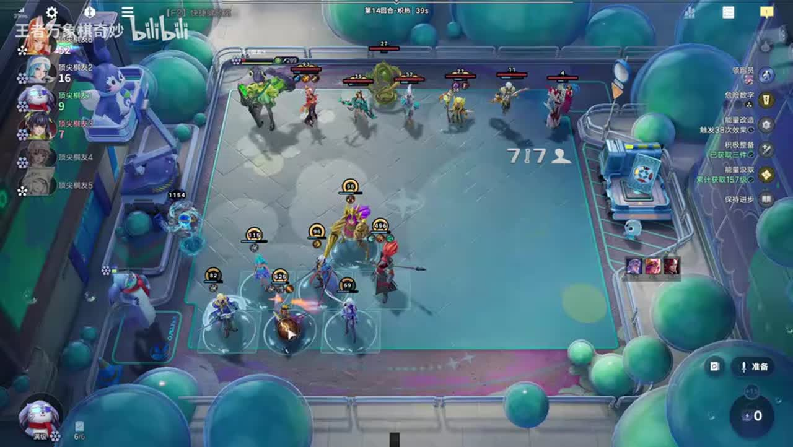

## 24:40–25:15 把层数与额外触发连接起来，认识正反馈增长。

- 事件 ID：BV1gvhD6gEHu:p1:e015
- 场景：实战
- 时机：解释核心加速时
- 背景（分析推断）：原稿后半有长重复ASR异常；每30层为讲者说法待核实。
- 学习目标（分析推断）：理解增长为何加速，避免将预测层数当成实测。
- 模板：mechanic-model
- ASR 段落：[40]

> 额外出发一次露娜或者出发一次这个整备

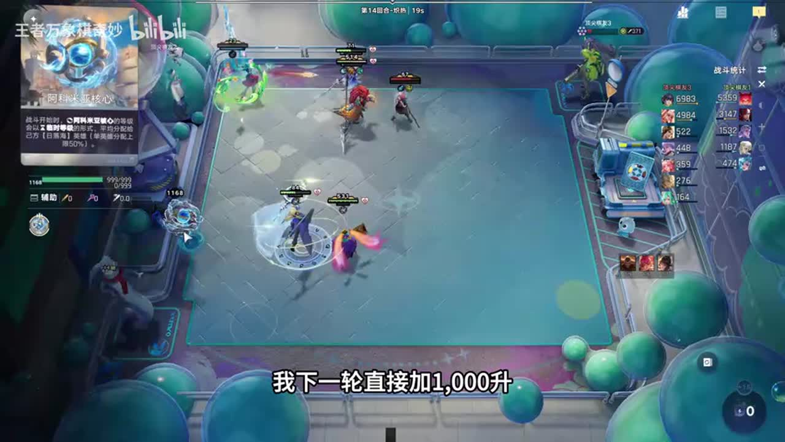

## 25:53–27:13 保留韩信即时战力，同时用露娜百分比伤害处理高耐久目标。

- 事件 ID：BV1gvhD6gEHu:p1:e016
- 场景：实战
- 时机：面对特殊海月时
- 背景（分析推断）：不能为了传承卖掉正在承担战斗的主核。
- 学习目标（分析推断）：按敌方机制选择输出，而非只看等级。
- 模板：counter-target
- ASR 段落：[42, 43]

> 不敢传韩信对呀我要打架呀

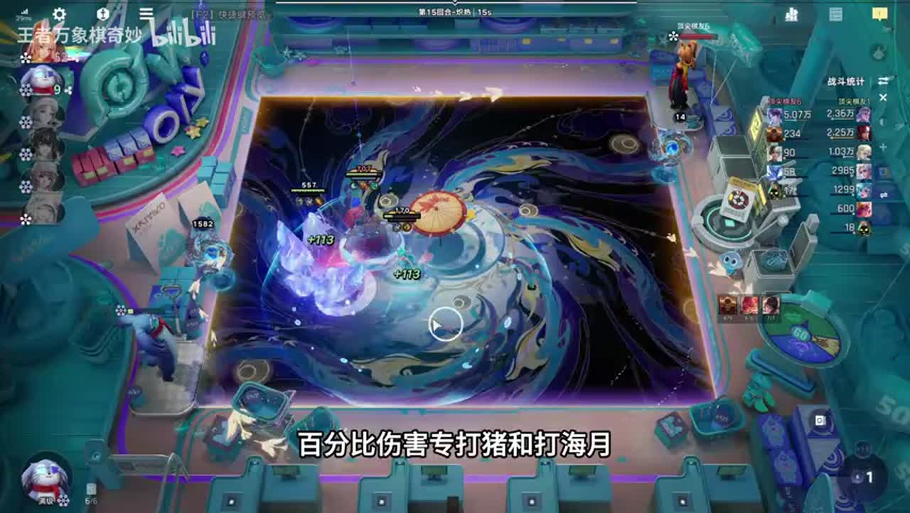

## 27:18–29:46 检查海诺觉醒和安琪拉去留；卖支撑会改变触发次数。

- 事件 ID：BV1gvhD6gEHu:p1:e017
- 场景：实战
- 时机：露娜触发减少时
- 背景（分析推断）：讲者发现成长低，补回安琪拉以恢复额外触发。
- 学习目标（分析推断）：转型前检查被移除单位的功能。
- 模板：combat-review
- ASR 段落：[44, 47]

> 安琪拉卖了少出发一个。

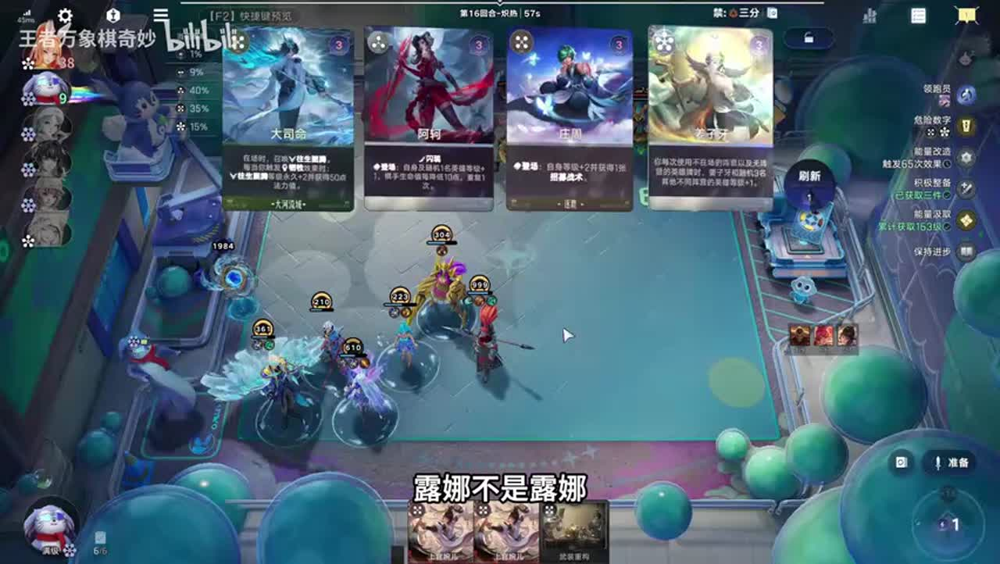

## 27:57–31:11 反思误卖保命支撑，优先补太乙而非继续纯成长。

- 事件 ID：BV1gvhD6gEHu:p1:e018
- 场景：实战
- 时机：最后一波需要太乙时
- 背景（分析推断）：讲者先认为不需要太乙，随后承认错误并重买。
- 学习目标（分析推断）：按剩余战斗数重排保命与成长优先级。
- 模板：late-transition
- ASR 段落：[45, 48, 49]

> 我刚刚不该卖你的

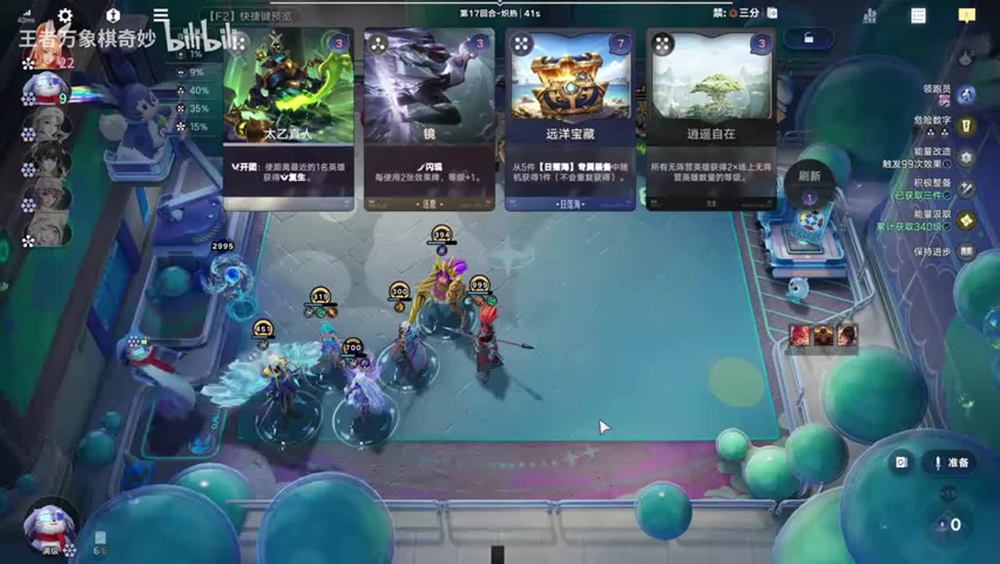

## 28:35–31:52 核对最高等级承伤与韩信飞行安全的预测；3000层仍不能保证赢。

- 事件 ID：BV1gvhD6gEHu:p1:e019
- 场景：实战
- 时机：最终对战失败时
- 背景（分析推断）：讲者预测不会被海月拉，实际被拉且获得第二名。
- 学习目标（分析推断）：用失败修正机制假设，避免等级即胜利的误解。
- 模板：combat-review
- ASR 段落：[46, 50]

> 三千层都没打过

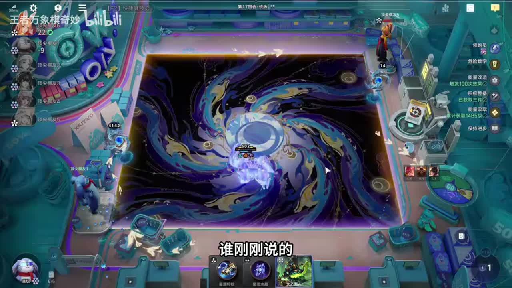

## 待核实与局限

- 原始ASR术语和数值可能有误；未经画面确认者不作为精确机制结论。
