# 阿离找不到遗址？根本不需要！直接养刘邦，从头强到尾，第一视角与思路解析

来源：https://www.bilibili.com/video/BV12NHS6BEEm/?p=1

分析状态：completed

完整文字稿：../../../raw/BV12NHS6BEEm_p1.md

## 00:02–02:13 关注刘邦或韩信，前期一轮少量击杀不必过度追求叠伞。

- 事件 ID：BV12NHS6BEEm:p1:e001
- 场景：实战
- 时机：阿离开局找主核时
- 背景（分析推断）：后期整队击杀更能积累，开局先建立路线。
- 学习目标（分析推断）：区别早期准备与后期成长速度。
- 模板：opening-plan
- ASR 段落：[1, 3]

> 你到后期一个回合杀七个

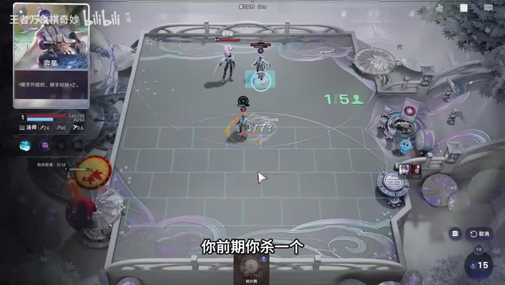

## 02:42–03:12 用高等级雅典娜艾琳、金钟馗，并按吃小鹿前后安排控制降级。

- 事件 ID：BV12NHS6BEEm:p1:e002
- 场景：前置讲解
- 时机：回答日落海打999李信时
- 背景（分析推断）：这是其他局势问答，不是本局实施；具体等级待核。
- 学习目标（分析推断）：按敌方触发顺序处理主核。
- 模板：counter-target
- ASR 段落：[5]

> 他吃完小路999他再吃一口金钟葵又掉到500了

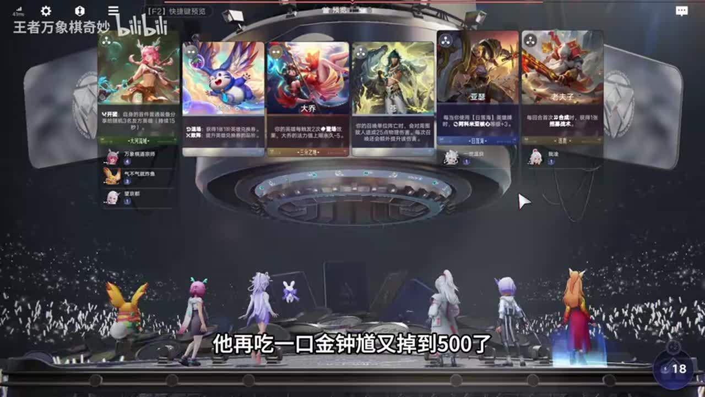

## 03:47–04:35 先再找一张再复印，避免复制后卡自己牌库。

- 事件 ID：BV12NHS6BEEm:p1:e003
- 场景：实战
- 时机：准备复印关键卡时
- 背景（分析推断）：主核与图腾仍缺牌，提前复印有竞争成本。
- 学习目标（分析推断）：理解库存与复制顺序。
- 模板：resource-order
- ASR 段落：[7]

> 现在复印是卡自己的,不能复印

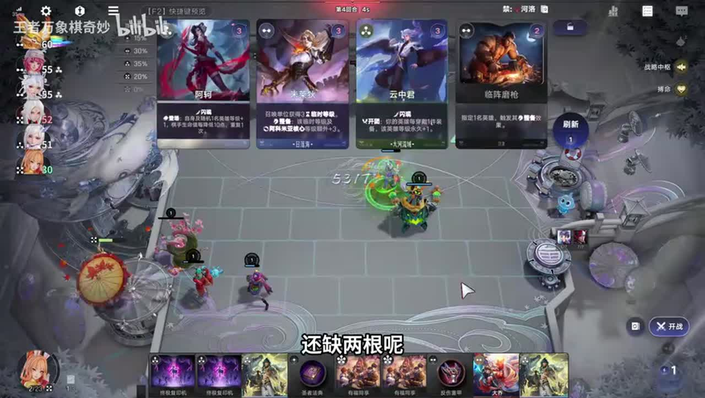

## 04:35–05:22 攻速已有4.0则不需要重复普攻收益，选择免控。

- 事件 ID：BV12NHS6BEEm:p1:e004
- 场景：实战
- 时机：四次普攻与免控二选时
- 背景（分析推断）：相同收益是否冗余取决于已有属性。
- 学习目标（分析推断）：按边际收益判断强化。
- 模板：talent-fit
- ASR 段落：[8]

> 我攻击力本来就4.0我不需要四次普攻

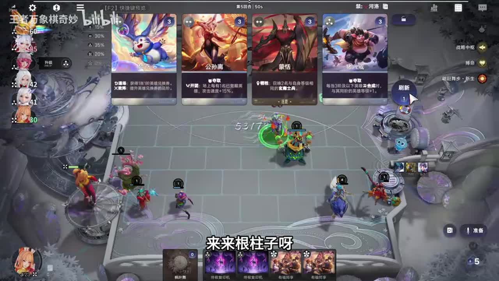

## 05:23–06:29 图腾不必都觉醒，先补缺的一根才有每轮成长。

- 事件 ID：BV12NHS6BEEm:p1:e005
- 场景：实战
- 时机：缺鬼谷子但少司缘已在时
- 背景（分析推断）：讲者少一根而成长慢，重点是功能完整性。
- 学习目标（分析推断）：区分数量补齐与高成本觉醒。
- 模板：module-fit
- ASR 段落：[9, 10]

> 觉不觉醒都是加十级

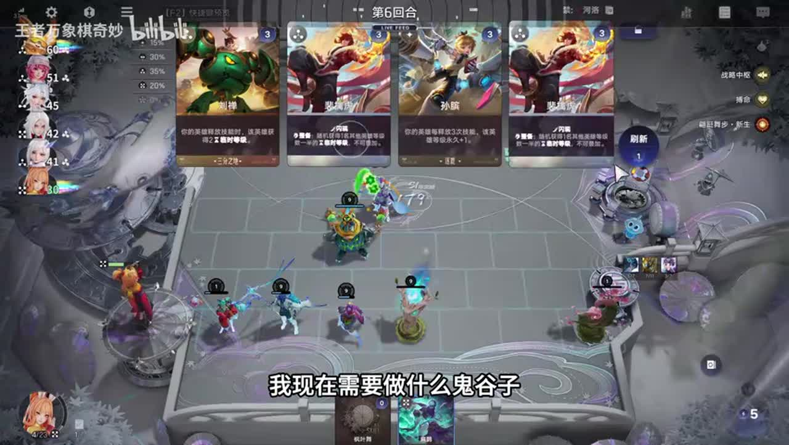

## 07:41–10:18 搜索只需一张功能位，别把主核成型误当成完整体系。

- 事件 ID：BV12NHS6BEEm:p1:e006
- 场景：实战
- 时机：持续缺图腾时
- 背景（分析推断）：鬼谷子迟来导致多轮成长缺失，夸张损失不作精确统计。
- 学习目标（分析推断）：识别搜索瓶颈的机会成本。
- 模板：economy-budget
- ASR 段落：[12, 13, 14]

> 我就要一张

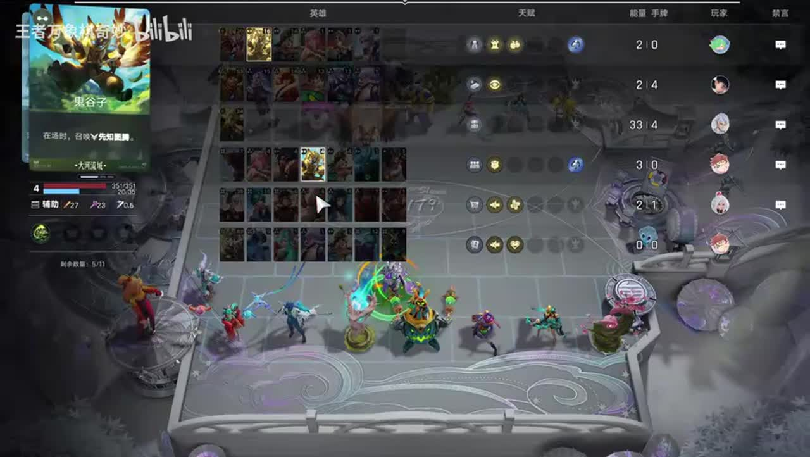

## 10:19–11:45 红叶染风与移植到齐才转，缺条件则刘邦继续打到决赛。

- 事件 ID：BV12NHS6BEEm:p1:e007
- 场景：实战
- 时机：有转海月计划时
- 背景（分析推断）：并非一定要转海月；当前战力足够保留路线。
- 学习目标（分析推断）：以实际组合条件决定转型。
- 模板：fallback-plan
- ASR 段落：[15, 16]

> 没有红颜染风我就不转了

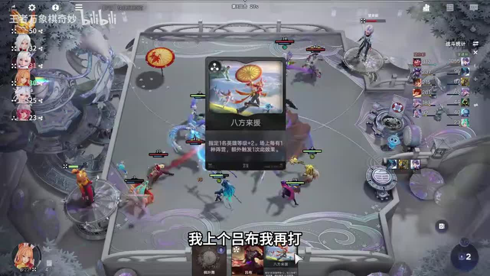

## 11:03–11:45 能打过则留到升级增加人口、上吕布后再兑现更多收益。

- 事件 ID：BV12NHS6BEEm:p1:e008
- 场景：实战
- 时机：暂不交八方来源时
- 背景（分析推断）：讲者没有即时稳血压力。
- 学习目标（分析推断）：把群体资源等到受益对象齐全。
- 模板：resource-order
- ASR 段落：[16]

> 反正我能打过对面我又不急着交

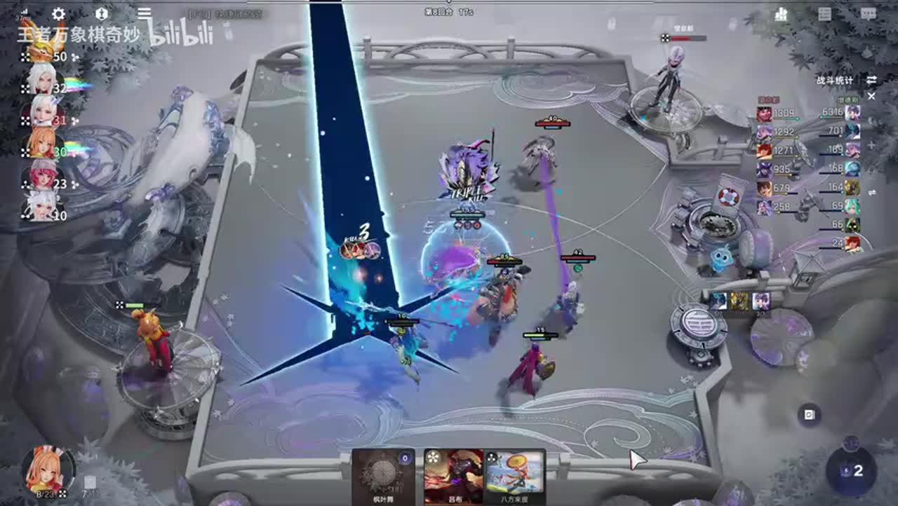

## 11:49–12:31 先补鬼谷子再升级，缺发动组件时升级不优先。

- 事件 ID：BV12NHS6BEEm:p1:e009
- 场景：实战
- 时机：解释此前延迟升级时
- 背景（分析推断）：搜不到关键图腾占用资源。
- 学习目标（分析推断）：按功能瓶颈调整升级节奏。
- 模板：level-transition
- ASR 段落：[17]

> 没鬼屋子没法升级了

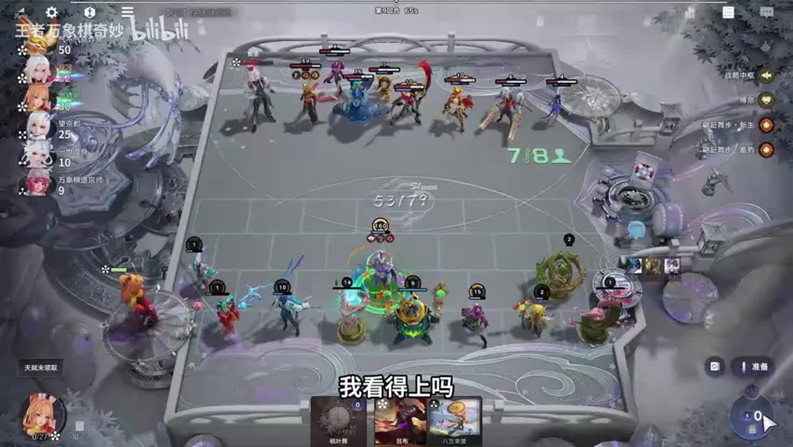

## 12:31–13:49 图腾围住刘邦，庇佑优先于刘邦吃图腾，收益先落地。

- 事件 ID：BV12NHS6BEEm:p1:e010
- 场景：实战
- 时机：拿到神明庇佑时
- 背景（分析推断）：讲者对照开战血量变化；静帧不证明优先级本身。
- 学习目标（分析推断）：理解同期开场技能顺序。
- 模板：growth-combo
- ASR 段落：[18, 19]

> 在刘邦吃之前就能生效

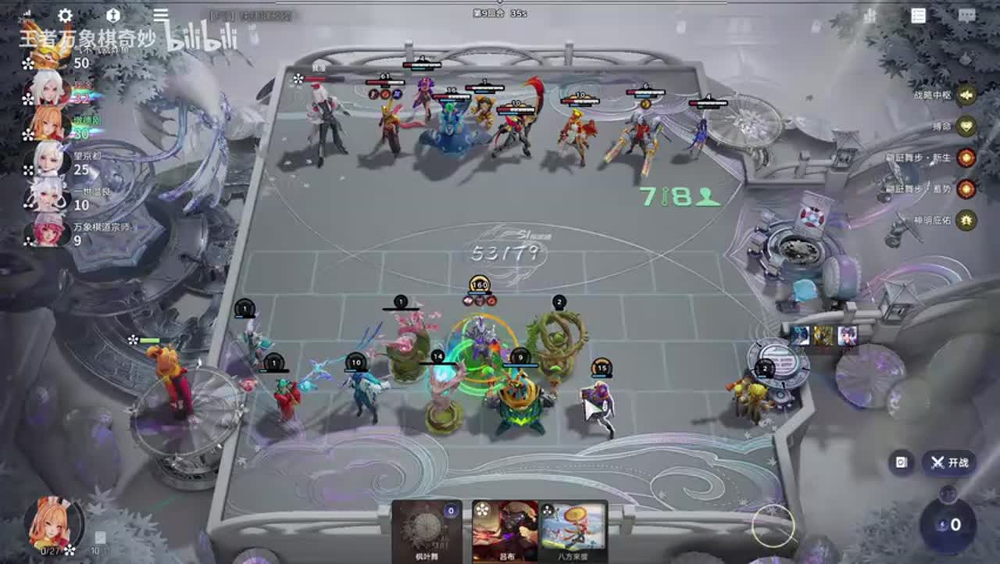

## 13:03–13:49 近战先站后面，等敌人前走再飞入后排。

- 事件 ID：BV12NHS6BEEm:p1:e011
- 场景：实战
- 时机：刘邦准备开战时
- 背景（分析推断）：不是默认近战前排；依赖伞位移与敌方走位。
- 学习目标（分析推断）：用延迟接敌打乱对方阵型。
- 模板：position-cause
- ASR 段落：[19]

> 你肯定得站后面的

## 13:50–15:04 选15刀额外转移条件，增加后续位移次数。

- 事件 ID：BV12NHS6BEEm:p1:e012
- 场景：实战
- 时机：六级选择伞技能时
- 背景（分析推断）：讲者不确定基础转移次数，不能把猜测写成精确规则。
- 学习目标（分析推断）：按选项文本解释收益，避免只记第几个。
- 模板：level-transition
- ASR 段落：[20, 21]

> 你A15刀,他就能多飞一次

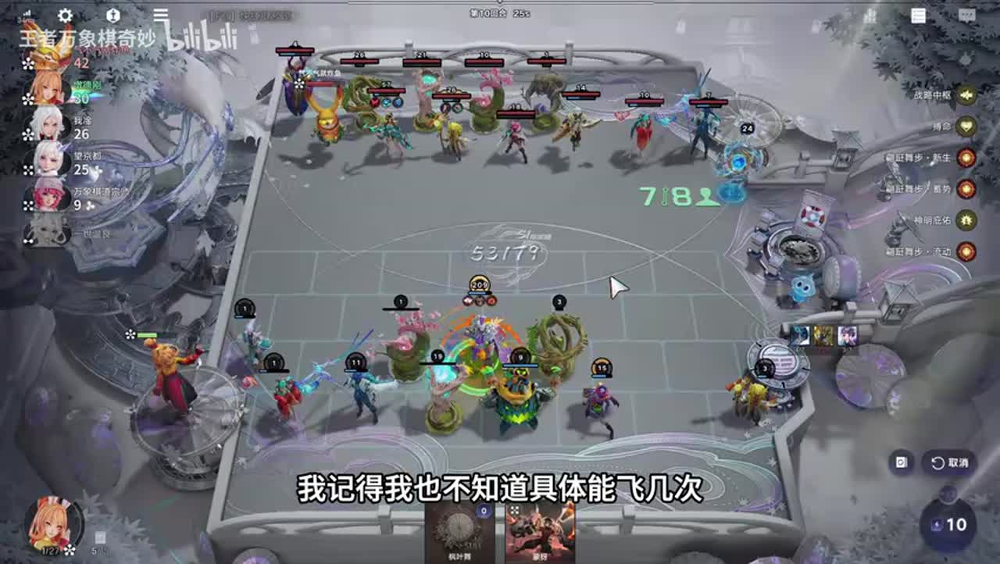

## 15:04–16:39 弈星过渡到四级抽刘邦和三图腾，刘邦法强转攻速使大书有用。

- 事件 ID：BV12NHS6BEEm:p1:e013
- 场景：实战
- 时机：总结无移植刘邦路线时
- 背景（分析推断）：本局直接使用刘邦，不靠移植转入。
- 学习目标（分析推断）：理解基础路线与属性协同。
- 模板：mechanic-model
- ASR 段落：[22, 23]

> 法强高攻速就快

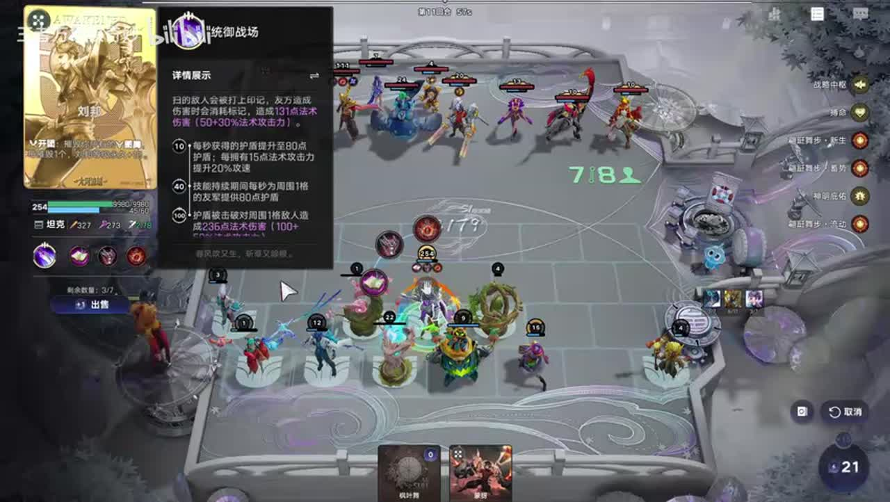

## 16:39–17:13 在可用阵营考虑李信；韩信只是待测试候选，不能作为已验证替代。

- 事件 ID：BV12NHS6BEEm:p1:e014
- 场景：实战
- 时机：抽不到刘邦时
- 背景（分析推断）：讲者明确说可以试但自己没试。
- 学习目标（分析推断）：把备选建议与验证程度分开。
- 模板：fallback-plan
- ASR 段落：[24]

> 你可以试一下。

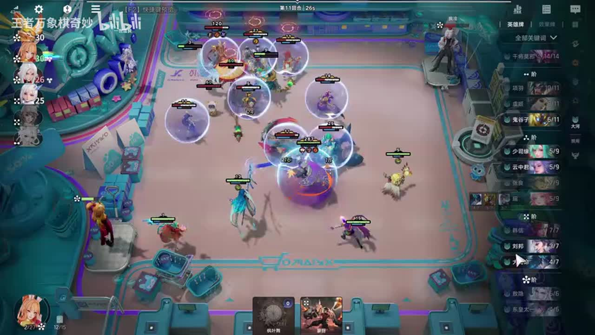

## 17:14–18:41 苍穹优先，剩余肉装；缺扁鹊会明显影响伤害。

- 事件 ID：BV12NHS6BEEm:p1:e015
- 场景：实战
- 时机：规划刘邦装备时
- 背景（分析推断）：讲者对本路线关键辅助与装备做条件说明。
- 学习目标（分析推断）：区分核心装备与可替代防护。
- 模板：equipment-role
- ASR 段落：[25, 26]

> 拿个苍穹就行了剩下的带肉装

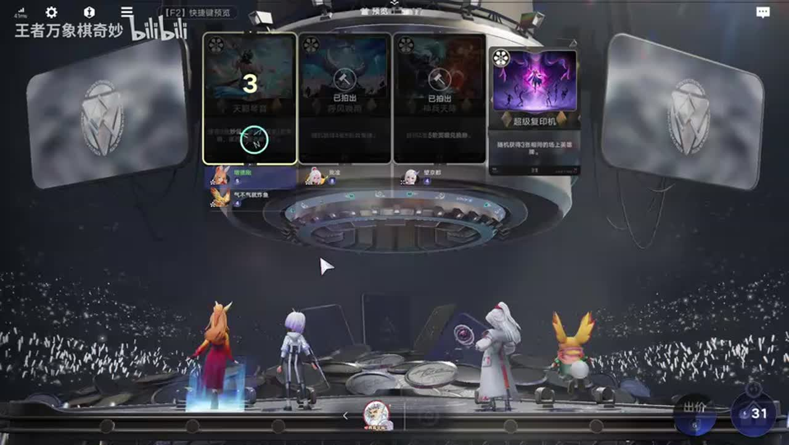

## 18:41–19:32 扁鹊先觉醒后再决定交相关觉醒资源，检查已有状态。

- 事件 ID：BV12NHS6BEEm:p1:e016
- 场景：实战
- 时机：扁鹊觉醒资源出现时
- 背景（分析推断）：觉醒进度改变资源需求。
- 学习目标（分析推断）：避免重复投入已兑现目标。
- 模板：resource-order
- ASR 段落：[27]

> 扁鹊既然已觉醒,那我直接觉醒他也

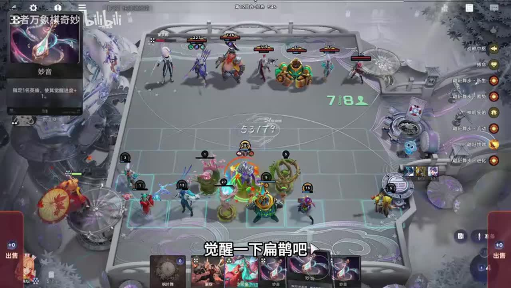

## 19:32–20:13 后排等敌人走出后飞入，打乱阵型；缺苍穹重伤需另检查。

- 事件 ID：BV12NHS6BEEm:p1:e017
- 场景：实战
- 时机：再次解释后排站位时
- 背景（分析推断）：不同于前次首次说明，是本轮对手下的站位问答。
- 学习目标（分析推断）：将接敌路径与装备缺口一起评估。
- 模板：position-cause
- ASR 段落：[28]

> 能打乱别人的阵型

## 20:51–21:50 其开场词条已生效，死后不会必然失去全部收益。

- 事件 ID：BV12NHS6BEEm:p1:e018
- 场景：实战
- 时机：扁鹊阵亡时
- 背景（分析推断）：讲者回答辅助死亡是否影响刘邦。
- 学习目标（分析推断）：区分开场生效和持续存活条件。
- 模板：mechanic-model
- ASR 段落：[30]

> 反正他开局就生效了

## 23:00–24:19 装备少不足做神器；瑶未100级时分属性机制不同，先到四级即可。

- 事件 ID：BV12NHS6BEEm:p1:e019
- 场景：实战
- 时机：考虑神器或让瑶吃图腾时
- 背景（分析推断）：讲者纠正盲目让瑶吃图腾，具体阈值由语音待核。
- 学习目标（分析推断）：避免向未达条件辅助浪费资源。
- 模板：economy-budget
- ASR 段落：[33, 34]

> 100级才会分属性

## 24:21–25:14 攻速足够则防护装备边际收益更大，不盲补输出。

- 事件 ID：BV12NHS6BEEm:p1:e020
- 场景：实战
- 时机：已高攻速还要圣剑时
- 背景（分析推断）：苍穹未到且装备不足。
- 学习目标（分析推断）：按已有属性识别装备冗余。
- 模板：equipment-cause
- ASR 段落：[35]

> 刘邦带圣剑还不如带件肉呢

## 25:17–26:22 拿到合适装备后继续刘邦，不为原定海月路线强行转型。

- 事件 ID：BV12NHS6BEEm:p1:e021
- 场景：实战
- 时机：战斗已经能赢时
- 背景（分析推断）：当前伤害和生存已达需求。
- 学习目标（分析推断）：以实际战力停止不必要转换。
- 模板：late-transition
- ASR 段落：[36, 37]

> 我这没必要转了呀

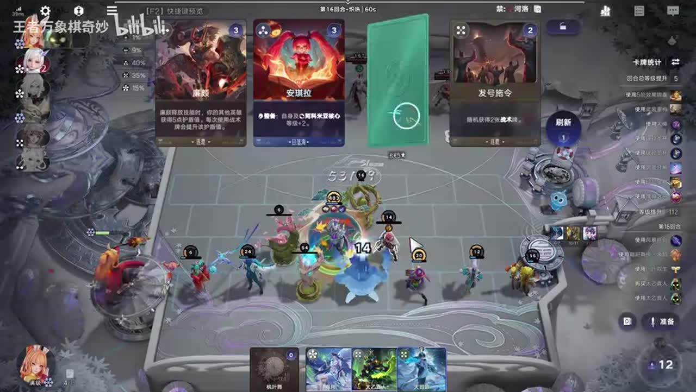

## 26:24–26:55 有法术伤害也有大量普攻物理伤害，物理吸血刀可有收益。

- 事件 ID：BV12NHS6BEEm:p1:e022
- 场景：实战
- 时机：查看刘邦伤害结构时
- 背景（分析推断）：按实际伤害面板解释，不能只按技能标签选装。
- 学习目标（分析推断）：以伤害组成匹配吸血类型。
- 模板：equipment-cause
- ASR 段落：[38]

> 他的物理伤害比法术伤害还要高

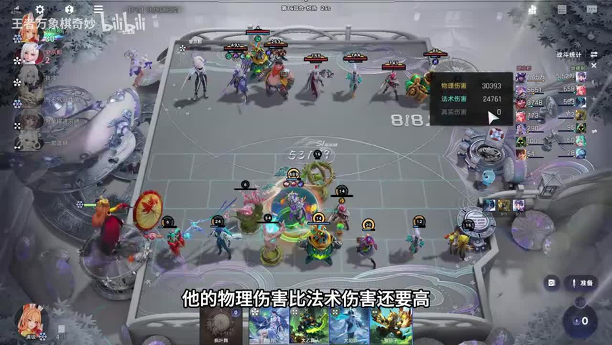

## 26:55–27:55 没有移植仍完成单杀，说明本路线并不必依赖遗址或移植。

- 事件 ID：BV12NHS6BEEm:p1:e023
- 场景：实战
- 时机：最终胜利后复盘移植缺失时
- 背景（分析推断）：本局是可行示例，不能据此证明所有局势都不需要。
- 学习目标（分析推断）：区分核心发动条件与可选转换工具。
- 模板：combat-review
- ASR 段落：[39, 40]

> 没一字我们需要一字嘛。

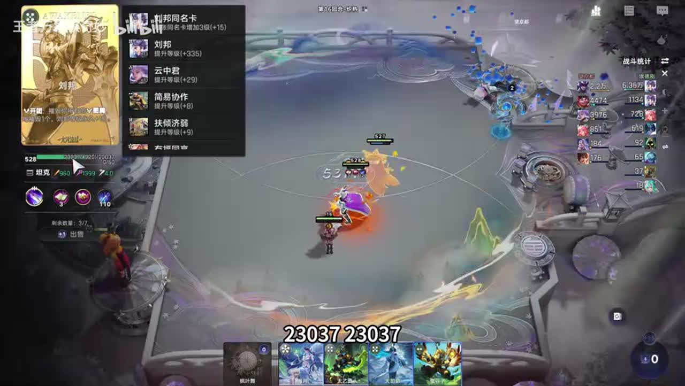

## 待核实与局限

- 原始ASR术语和数值可能有误；未经画面确认者不作为精确机制结论。
