# 韩信史诗级增强，姜导15回合850级韩信

来源：https://www.bilibili.com/video/BV14Jac6cEXY/?p=1

分析状态：completed

完整文字稿：../../../raw/BV14Jac6cEXY_p1.md

## 00:00–01:04 亚连莱迪朵莉亚雅典娜等整备链给韩信加级，前期弈星狂铁保血

- 事件 ID：BV14Jac6cEXY:p1:e001
- 场景：实战
- 时机：韩信转日落海整备
- 背景（分析推断）：本局姜子牙养日落海整备韩信，韩信八回合迟到，成长快但中期无回复被控，后升六补战力；韩信转日落海整备，具体条件依据所引前后文。
- 学习目标（分析推断）：把核心成长所需支撑与过渡分开
- 模板：opening-plan
- ASR 段落：[1, 2]

> 前期少掉点血

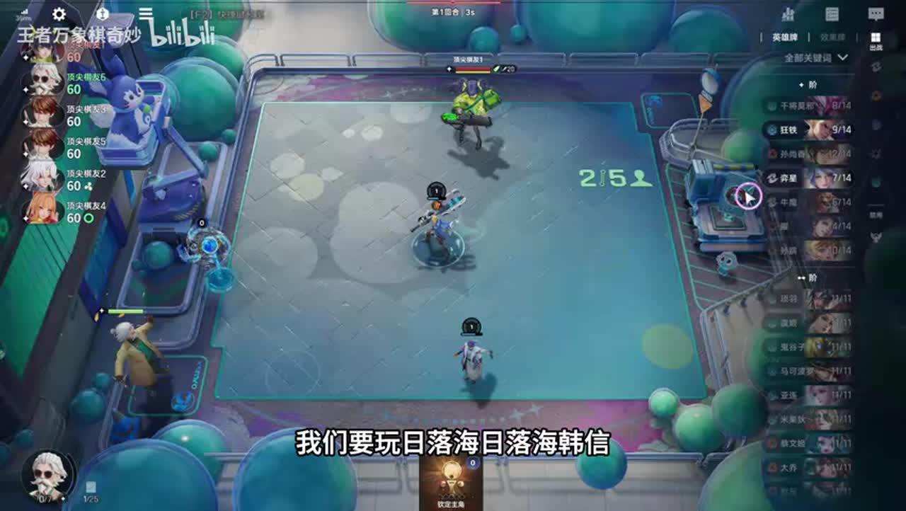

## 01:04–01:36 外部无赢律可升级，买椟用于稍后复制获取觉醒韩信

- 事件 ID：BV14Jac6cEXY:p1:e002
- 场景：实战
- 时机：外面没有赢律时升级与买椟
- 背景（分析推断）：本局姜子牙养日落海整备韩信，韩信八回合迟到，成长快但中期无回复被控，后升六补战力；外面没有赢律时升级与买椟，具体条件依据所引前后文。
- 学习目标（分析推断）：结合外部节奏与关键复制资源
- 模板：level-transition
- ASR 段落：[3]

> 外面没有盈律

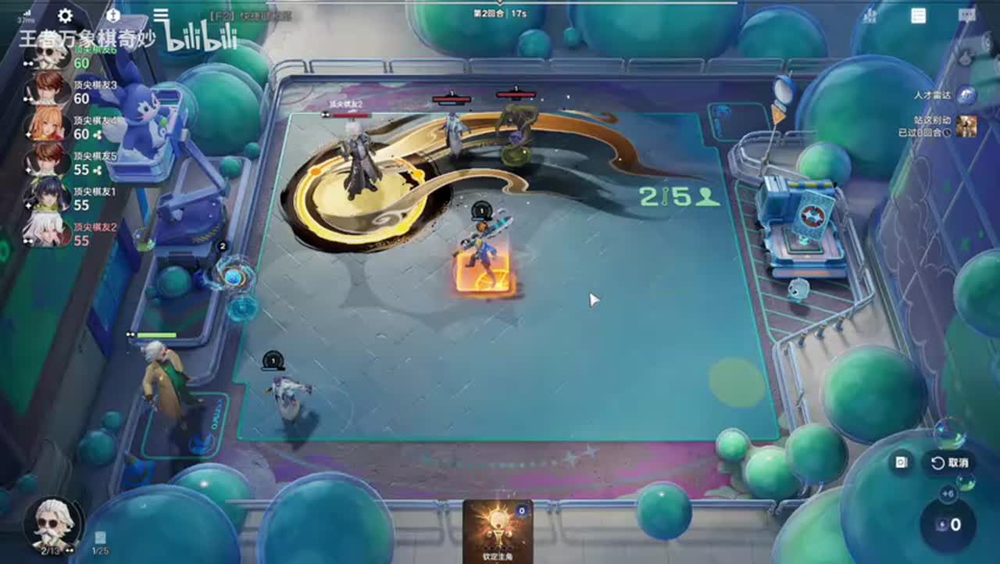

## 01:36–02:07 亚连给装备最多英雄成长，准备集中装备给韩信并上朵莉亚发动整备

- 事件 ID：BV14Jac6cEXY:p1:e003
- 场景：实战
- 时机：亚连等级给谁
- 背景（分析推断）：本局姜子牙养日落海整备韩信，韩信八回合迟到，成长快但中期无回复被控，后升六补战力；亚连等级给谁，具体条件依据所引前后文。
- 学习目标（分析推断）：控制自动技能的受益目标
- 模板：position-binding
- ASR 段落：[4]

> 给装备最多的英雄加等级

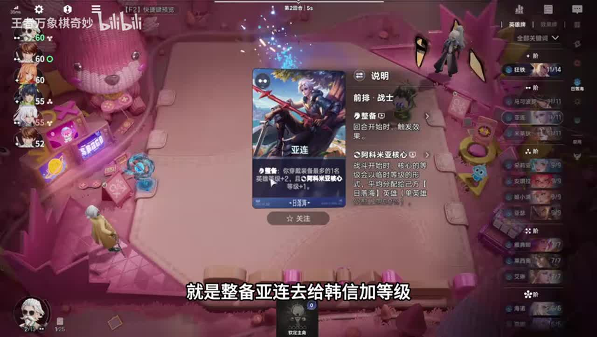

## 02:07–03:51 复制格先空着，拍卖抢有用英雄快上；实际拿云中君复制并希望神鹰锻造

- 事件 ID：BV14Jac6cEXY:p1:e004
- 场景：实战
- 时机：拍卖后赶在复制触发前上场
- 背景（分析推断）：本局姜子牙养日落海整备韩信，韩信八回合迟到，成长快但中期无回复被控，后升六补战力；拍卖后赶在复制触发前上场，具体条件依据所引前后文。
- 学习目标（分析推断）：把回合自动窗口与拍卖后的上场连接
- 模板：resource-order
- ASR 段落：[5, 6, 7]

> 每过一个回合复制此格子上的一个人

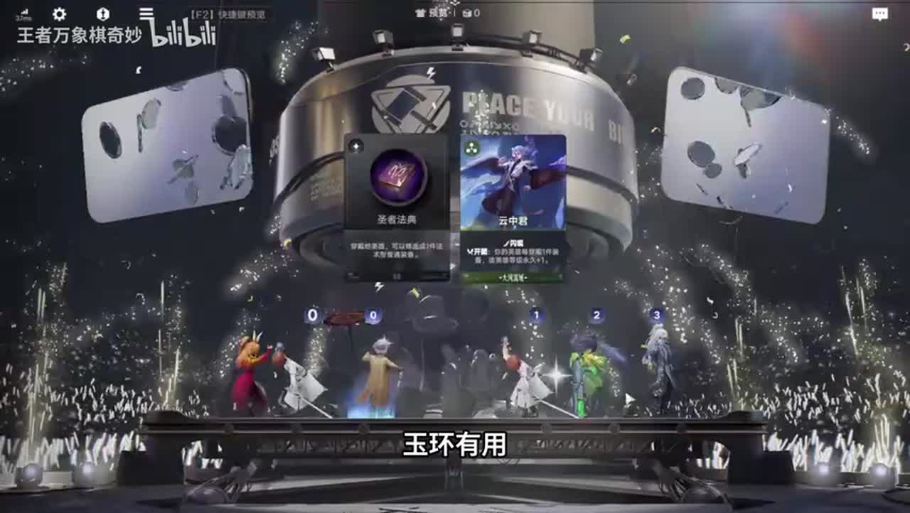

## 03:17–04:21 十张可指定加五，但前期负担高；无影手留找韩信，莱迪贵先一张

- 事件 ID：BV14Jac6cEXY:p1:e005
- 场景：实战
- 时机：前期不急打十张主角
- 背景（分析推断）：本局姜子牙养日落海整备韩信，韩信八回合迟到，成长快但中期无回复被控，后升六补战力；前期不急打十张主角，具体条件依据所引前后文。
- 学习目标（分析推断）：比较触发代价与当前获取核心目标
- 模板：economy-budget
- ASR 段落：[7, 8]

> 你一个回合打十张卡

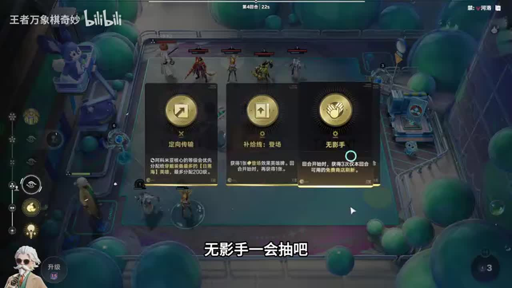

## 04:22–06:03 韩信不觉醒加二觉醒加四，亚连不再只限定日落海受益者，更多等级变化可配封神一瞬

- 事件 ID：BV14Jac6cEXY:p1:e006
- 场景：实战
- 时机：韩信与亚连增强说明
- 背景（分析推断）：本局姜子牙养日落海整备韩信，韩信八回合迟到，成长快但中期无回复被控，后升六补战力；韩信与亚连增强说明，具体条件依据所引前后文。
- 学习目标（分析推断）：读取新词条对成长链的影响
- 模板：version-change
- ASR 段落：[9, 10, 11]

> 现在他不用管你是不是日落海了

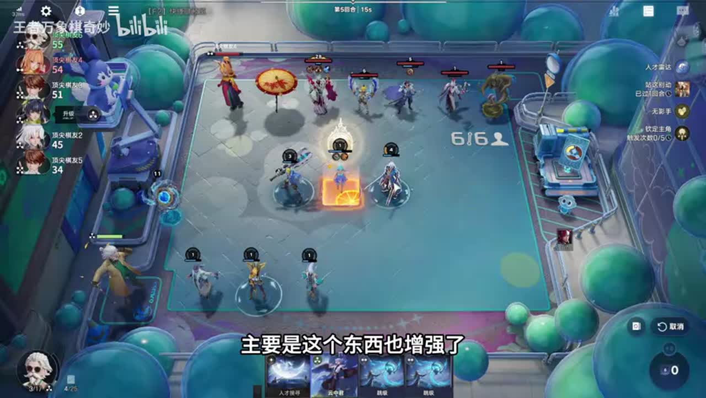

## 06:05–06:44 小技能可换，25级得到的大技能不能换

- 事件 ID：BV14Jac6cEXY:p1:e007
- 场景：实战
- 时机：封神一瞬能换人吗
- 背景（分析推断）：本局姜子牙养日落海整备韩信，韩信八回合迟到，成长快但中期无回复被控，后升六补战力；封神一瞬能换人吗，具体条件依据所引前后文。
- 学习目标（分析推断）：识别不可逆的核心绑定
- 模板：mechanic-model
- ASR 段落：[12]

> 大的是不能换的

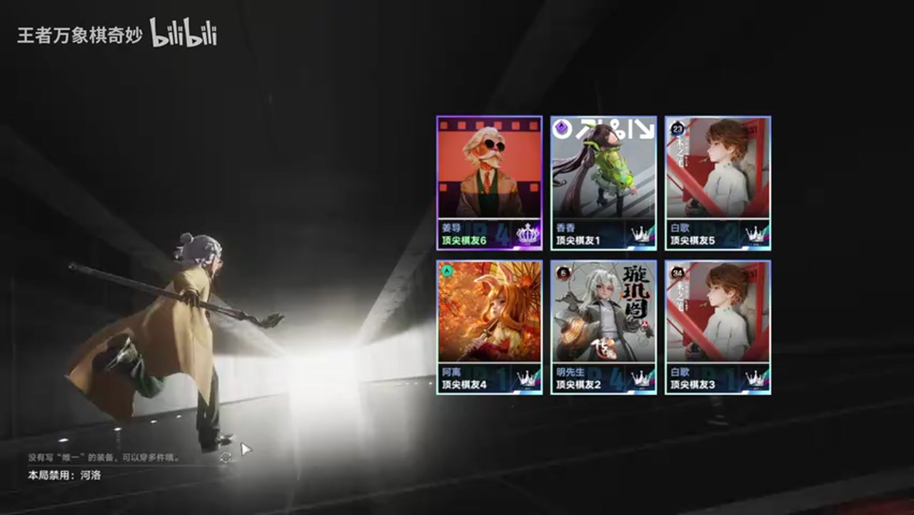

## 06:44–07:57 想升四找韩信但连续拿免费牌延误，先升级或收完关键觉醒再上人才搜寻

- 事件 ID：BV14Jac6cEXY:p1:e008
- 场景：实战
- 时机：免费牌诱惑拖慢升四
- 背景（分析推断）：本局姜子牙养日落海整备韩信，韩信八回合迟到，成长快但中期无回复被控，后升六补战力；免费牌诱惑拖慢升四，具体条件依据所引前后文。
- 学习目标（分析推断）：保留升本预算并承认搜牌的机会成本
- 模板：economy-budget
- ASR 段落：[13, 14]

> 别收了先升级

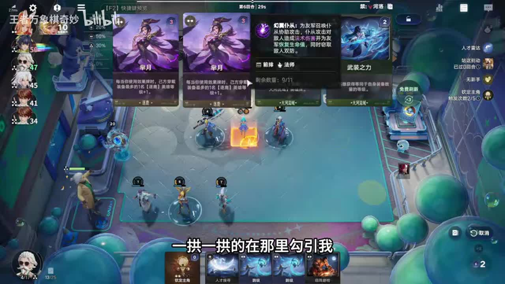

## 07:57–08:58 朵莉亚先到25解锁封神一瞬，韩信到手即可给主角并阶数升到五

- 事件 ID：BV14Jac6cEXY:p1:e009
- 场景：实战
- 时机：韩信未到先养另一人25级
- 背景（分析推断）：本局姜子牙养日落海整备韩信，韩信八回合迟到，成长快但中期无回复被控，后升六补战力；韩信未到先养另一人25级，具体条件依据所引前后文。
- 学习目标（分析推断）：预先满足通用解锁门槛，加快迟到核心启动
- 模板：resource-order
- ASR 段落：[15, 16]

> 她先到25级我韩信一来

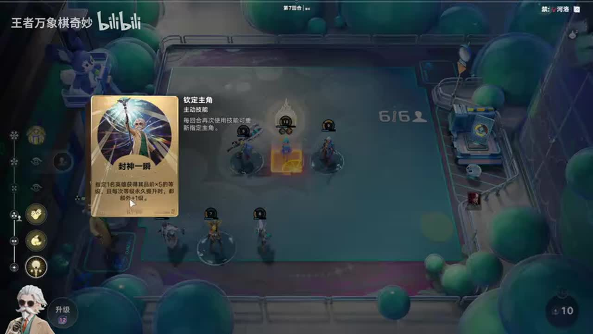

## 08:22–09:37 每触发整备随机英雄加级，多整备位让朵莉亚反复供给，优先觉醒可放大

- 事件 ID：BV14Jac6cEXY:p1:e010
- 场景：实战
- 时机：朵莉亚为什么不止两次触发
- 背景（分析推断）：本局姜子牙养日落海整备韩信，韩信八回合迟到，成长快但中期无回复被控，后升六补战力；朵莉亚为什么不止两次触发，具体条件依据所引前后文。
- 学习目标（分析推断）：把触发次数与上场整备数量联系
- 模板：growth-combo
- ASR 段落：[16, 17]

> 他至少出发三次

## 09:37–10:56 韩信未到血量承压，玉环庄周也可按卡数收益竞价；庄周三次封神，有火鹰装备仍拒绝

- 事件 ID：BV14Jac6cEXY:p1:e011
- 场景：实战
- 时机：拍卖补关键韩信与替代供给
- 背景（分析推断）：本局姜子牙养日落海整备韩信，韩信八回合迟到，成长快但中期无回复被控，后升六补战力；拍卖补关键韩信与替代供给，具体条件依据所引前后文。
- 学习目标（分析推断）：以核心缺口和可发动资源估价，不只看装备能带
- 模板：auction-choice
- ASR 段落：[18, 19]

> 庄周当三张卡用

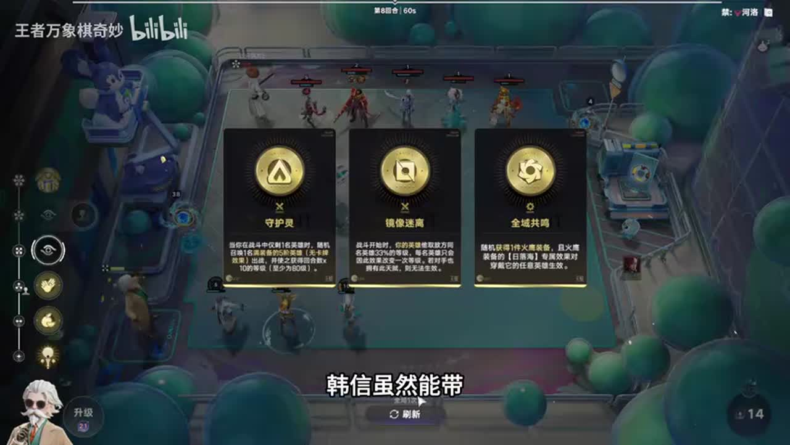

## 10:12–11:59 核心到手移除过渡，先25级绑定封神一瞬，再集中主角装备刀火跳级，补莱迪

- 事件 ID：BV14Jac6cEXY:p1:e012
- 场景：实战
- 时机：韩信终于到手集中成长
- 背景（分析推断）：本局姜子牙养日落海整备韩信，韩信八回合迟到，成长快但中期无回复被控，后升六补战力；韩信终于到手集中成长，具体条件依据所引前后文。
- 学习目标（分析推断）：按启动链排序，避免稀有成长给过渡
- 模板：resource-order
- ASR 段落：[19, 20, 21]

> 主角给韩大人

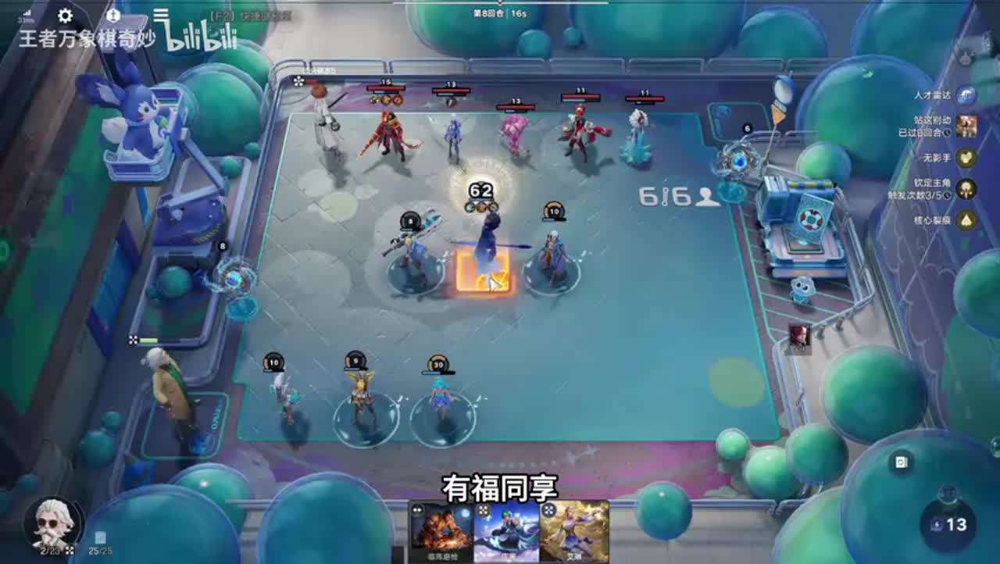

## 11:59–12:57 雅典娜补支撑，其他牌先上再卖使主角触发次数满

- 事件 ID：BV14Jac6cEXY:p1:e013
- 场景：实战
- 时机：上场再卖杂鱼补主角
- 背景（分析推断）：本局姜子牙养日落海整备韩信，韩信八回合迟到，成长快但中期无回复被控，后升六补战力；上场再卖杂鱼补主角，具体条件依据所引前后文。
- 学习目标（分析推断）：理解上场事件与出售不同的触发
- 模板：growth-combo
- ASR 段落：[22, 23]

> 咱们这些卡丢到场上再卖

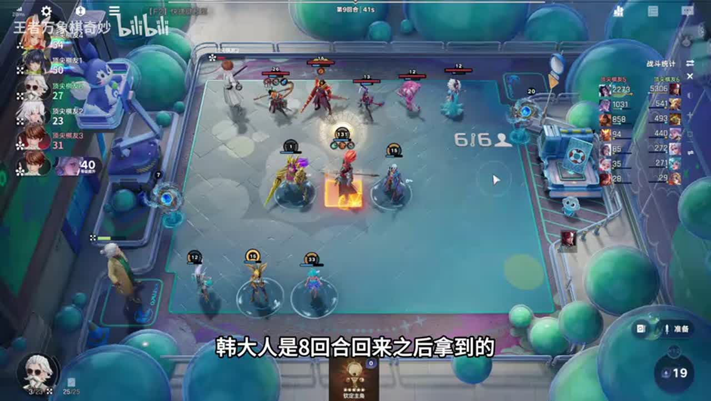

## 12:57–13:44 讲者对比新旧词条并建议鸡爪适配上挑，仍缺明刀保命

- 事件 ID：BV14Jac6cEXY:p1:e014
- 场景：实战
- 时机：韩信技能与鸡爪
- 背景（分析推断）：本局姜子牙养日落海整备韩信，韩信八回合迟到，成长快但中期无回复被控，后升六补战力；韩信技能与鸡爪，具体条件依据所引前后文。
- 学习目标（分析推断）：装备适配核心实际攻击与施法方式
- 模板：equipment-role
- ASR 段落：[24]

> 这个韩信带鸡爪很屌

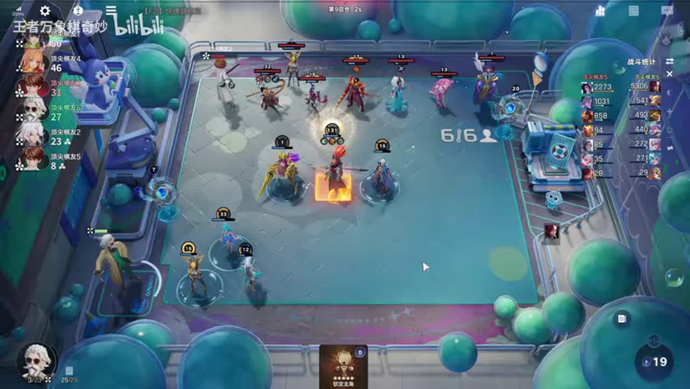

## 13:48–15:26 韩信觉醒从复制格下来，补朵莉亚觉醒、整装备与明刀司命；猴子也是整备可临时加级

- 事件 ID：BV14Jac6cEXY:p1:e015
- 场景：实战
- 时机：复制格完成觉醒后换位
- 背景（分析推断）：本局姜子牙养日落海整备韩信，韩信八回合迟到，成长快但中期无回复被控，后升六补战力；复制格完成觉醒后换位，具体条件依据所引前后文。
- 学习目标（分析推断）：关键复制收益兑现后重配目标与装备
- 模板：resource-order
- ASR 段落：[25, 26, 27]

> 寒大人觉醒从这个格上下来吧

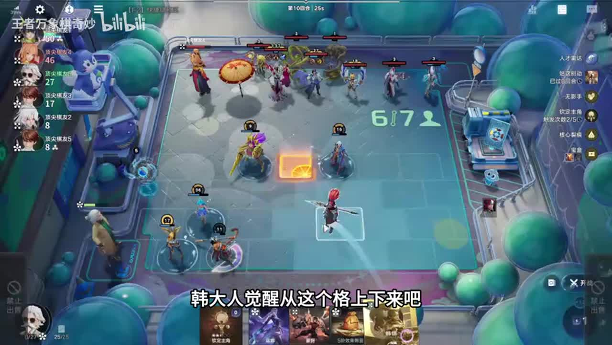

## 15:29–16:04 讲者认为没明刀司命会被170级干将单杀，等级仍上涨但不能替代保命

- 事件 ID：BV14Jac6cEXY:p1:e016
- 场景：实战
- 时机：高等级仍可能被干将击杀
- 背景（分析推断）：本局姜子牙养日落海整备韩信，韩信八回合迟到，成长快但中期无回复被控，后升六补战力；高等级仍可能被干将击杀，具体条件依据所引前后文。
- 学习目标（分析推断）：识别等级与生存短板的区别
- 模板：combat-review
- ASR 段落：[28]

> 不出明刀师命

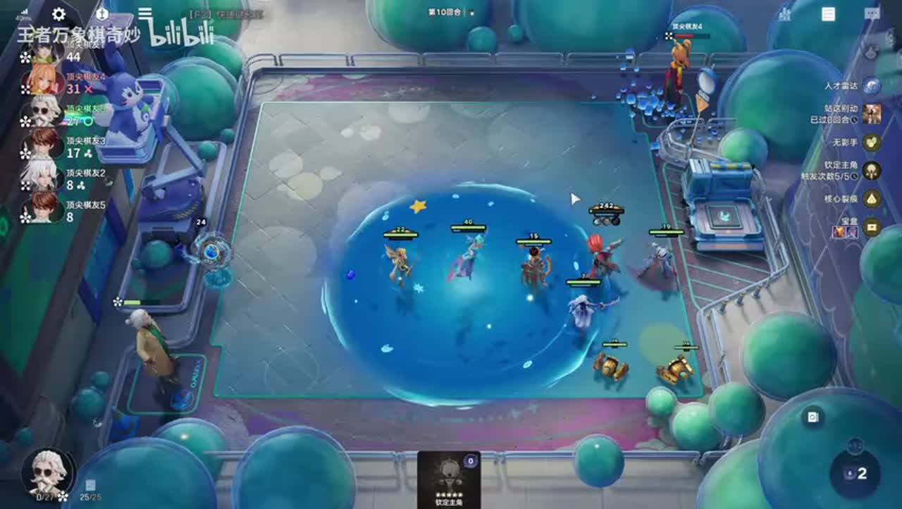

## 16:04–17:34 朵莉亚整备加级、韩信自身每次整备加级、亚连与刀火分别触发封神一瞬；六级可带吸血省炽热位

- 事件 ID：BV14Jac6cEXY:p1:e017
- 场景：实战
- 时机：为何回合开始猛涨等级
- 背景（分析推断）：本局姜子牙养日落海整备韩信，韩信八回合迟到，成长快但中期无回复被控，后升六补战力；为何回合开始猛涨等级，具体条件依据所引前后文。
- 学习目标（分析推断）：追溯各成长来源，不误判为无条件自动无敌
- 模板：mechanic-model
- ASR 段落：[29, 30, 31]

> 他是一个一个算的

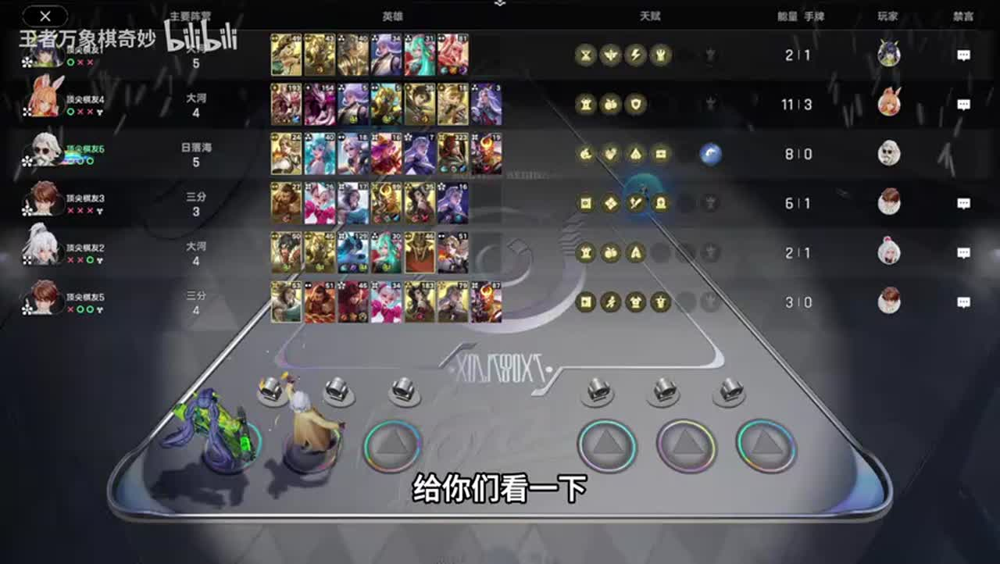

## 17:34–18:15 多个四级支撑符合时选众星拱月，韩信是唯一主要受益者

- 事件 ID：BV14Jac6cEXY:p1:e018
- 场景：实战
- 时机：众星拱月集中韩信
- 背景（分析推断）：本局姜子牙养日落海整备韩信，韩信八回合迟到，成长快但中期无回复被控，后升六补战力；众星拱月集中韩信，具体条件依据所引前后文。
- 学习目标（分析推断）：先检查等级门槛和集中收益
- 模板：talent-fit
- ASR 段落：[32]

> 直接重新拱月

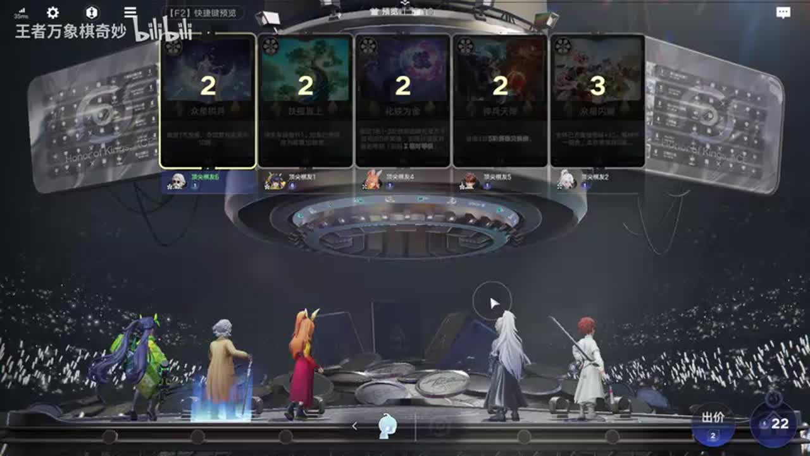

## 19:25–21:46 升六有吸血省炽热位置，欲升却预算不足，重新算能量与下轮收入

- 事件 ID：BV14Jac6cEXY:p1:e019
- 场景：实战
- 时机：无回复打山鬼乏力
- 背景（分析推断）：本局姜子牙养日落海整备韩信，韩信八回合迟到，成长快但中期无回复被控，后升六补战力；无回复打山鬼乏力，具体条件依据所引前后文。
- 学习目标（分析推断）：用战斗缺口决定升级并保留准确预算
- 模板：level-transition
- ASR 段落：[35, 36, 37, 38]

> 升六级的话他加30%的吸血了

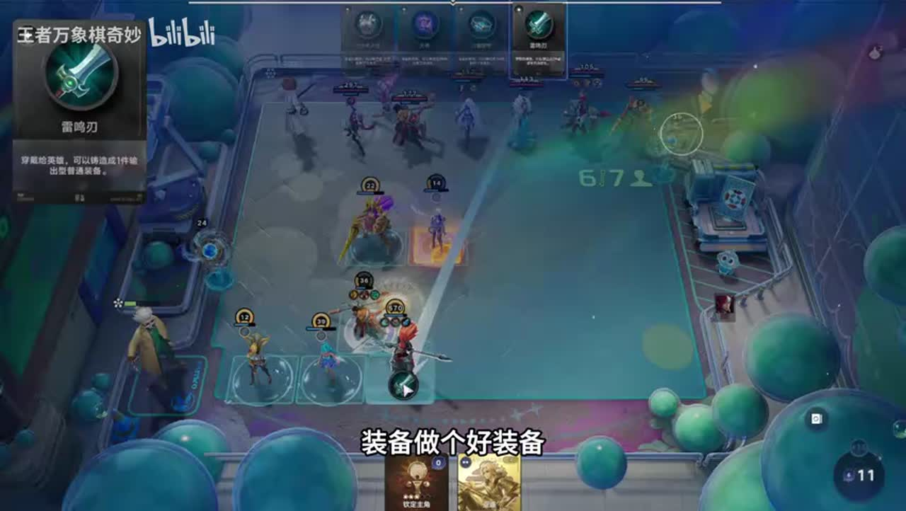

## 21:13–22:48 意识到被控与无回复问题，升六补15秒免控吸血，继续找复活甲明刀

- 事件 ID：BV14Jac6cEXY:p1:e020
- 场景：实战
- 时机：600级仍输低等级阵容
- 背景（分析推断）：本局姜子牙养日落海整备韩信，韩信八回合迟到，成长快但中期无回复被控，后升六补战力；600级仍输低等级阵容，具体条件依据所引前后文。
- 学习目标（分析推断）：先诊断控制生存而非只堆等级
- 模板：combat-review
- ASR 段落：[38, 39, 40]

> 被空烂了

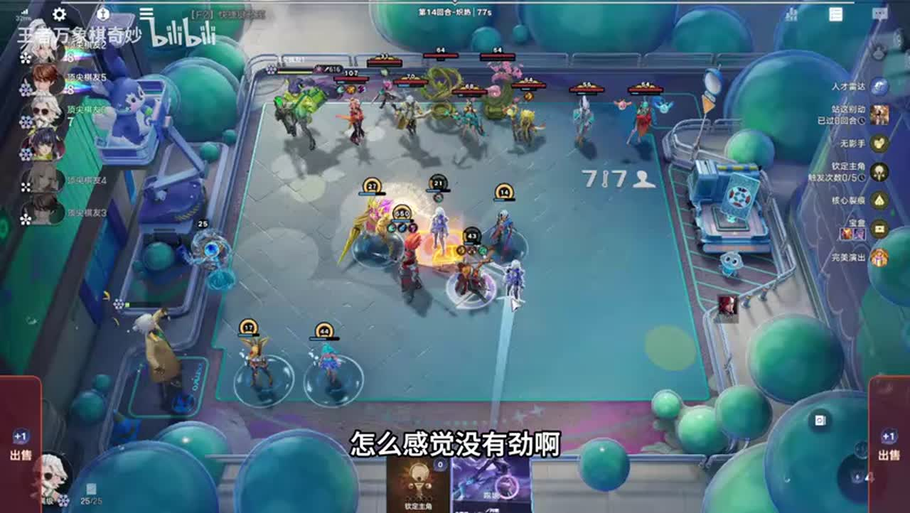

## 22:50–23:57 回血能持续续航，露娜成长位可换太乙；山鬼对局还受到对方墨子辅助影响

- 事件 ID：BV14Jac6cEXY:p1:e021
- 场景：实战
- 时机：到六级后改补太乙保命
- 背景（分析推断）：本局姜子牙养日落海整备韩信，韩信八回合迟到，成长快但中期无回复被控，后升六补战力；到六级后改补太乙保命，具体条件依据所引前后文。
- 学习目标（分析推断）：终局从成长工具切向战斗功能并识别辅助
- 模板：late-transition
- ASR 段落：[41, 42]

> 这个太一会得上了

## 23:57–24:33 倒转对手死亡后讲者观察露娜释放，仍评估此时露娜收益不高可卖

- 事件 ID：BV14Jac6cEXY:p1:e022
- 场景：实战
- 时机：对手淘汰释放露娜
- 背景（分析推断）：本局姜子牙养日落海整备韩信，韩信八回合迟到，成长快但中期无回复被控，后升六补战力；对手淘汰释放露娜，具体条件依据所引前后文。
- 学习目标（分析推断）：理解淘汰改变卡池但可用不等于必用
- 模板：combat-review
- ASR 段落：[43]

> 我的露娜放出来了

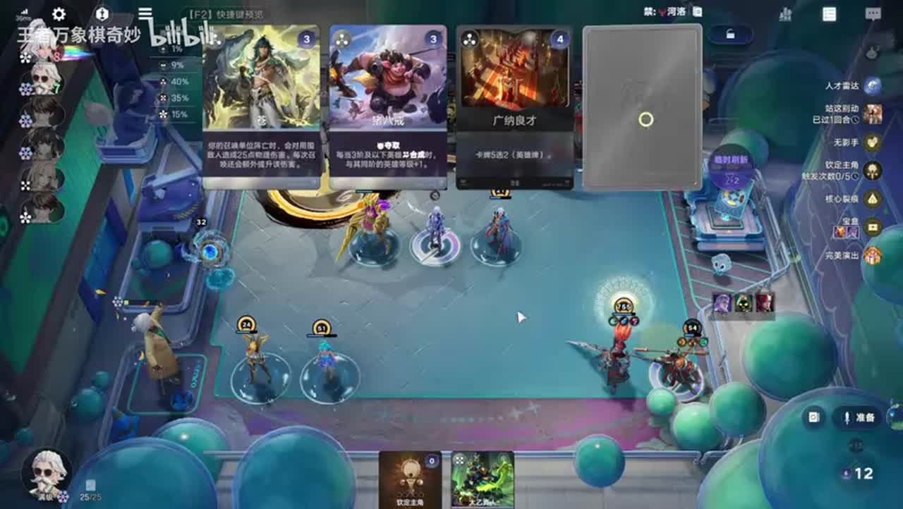

## 24:33–25:37 刀火封神一瞬主角众星朵莉亚亚连分别贡献，区分基础20与累计190

- 事件 ID：BV14Jac6cEXY:p1:e023
- 场景：实战
- 时机：查看等级来源分布
- 背景（分析推断）：本局姜子牙养日落海整备韩信，韩信八回合迟到，成长快但中期无回复被控，后升六补战力；查看等级来源分布，具体条件依据所引前后文。
- 学习目标（分析推断）：用来源面板检验成长假设
- 模板：combat-review
- ASR 段落：[44, 45]

> 这个190主角32

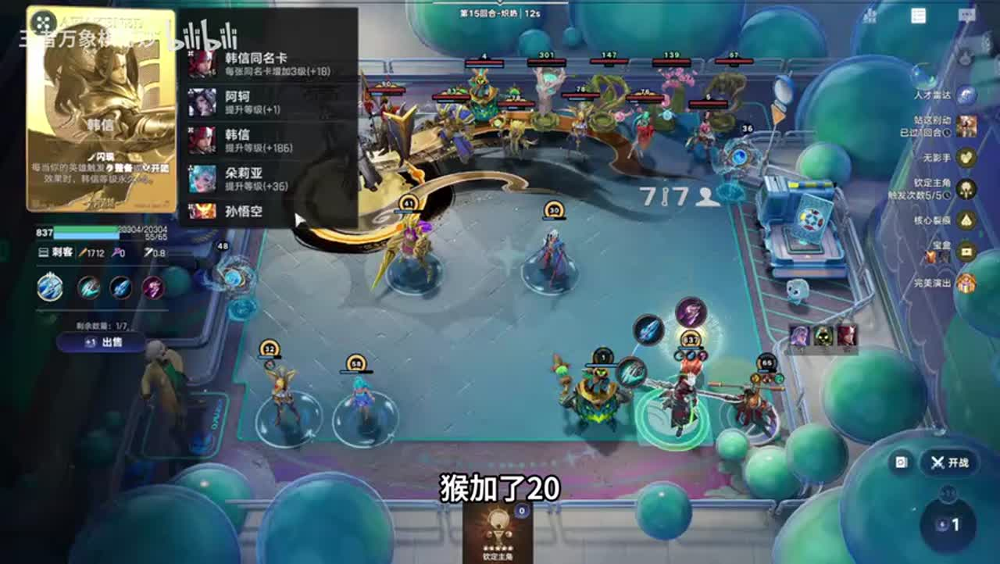

## 25:37–26:29 观察对方柱子被杀导致无法召山鬼，六级吸血维持血量

- 事件 ID：BV14Jac6cEXY:p1:e024
- 场景：实战
- 时机：韩信先偷掉对手图腾
- 背景（分析推断）：本局姜子牙养日落海整备韩信，韩信八回合迟到，成长快但中期无回复被控，后升六补战力；韩信先偷掉对手图腾，具体条件依据所引前后文。
- 学习目标（分析推断）：攻击发动支撑可以瓦解高等级核心
- 模板：counter-target
- ASR 段落：[46, 47]

> 他招不出来山鬼了

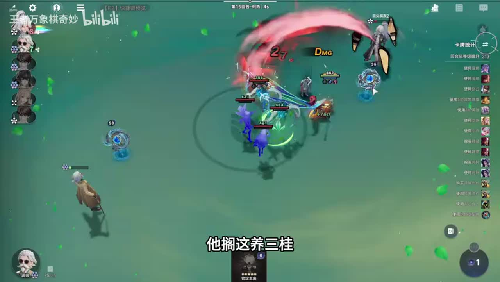

## 待核实与局限

- 不做ASR修正；刀火、主角及技能同音词保留原始证据。
- 讲者更新增强一倍、加级次数、30%吸血与15秒免控是当时版本解释，未独立测量。
- 复制格拍卖后快速上场实际示范需截图配合，手速窗口不推广为所有自动技能。
- 第38段与39段连贯失败复盘，不把初始等级压制预测当已验证结论。
- 第46段按讲者及画面观察记录图腾被击杀，不从胜利推导学习效果。
