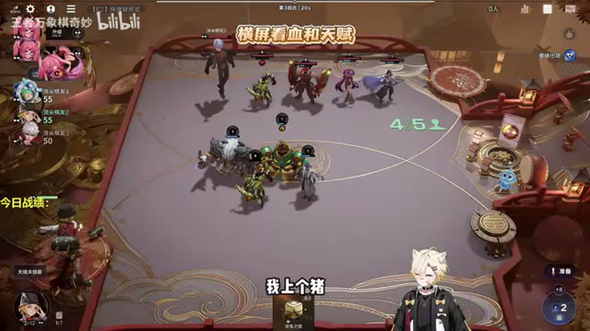
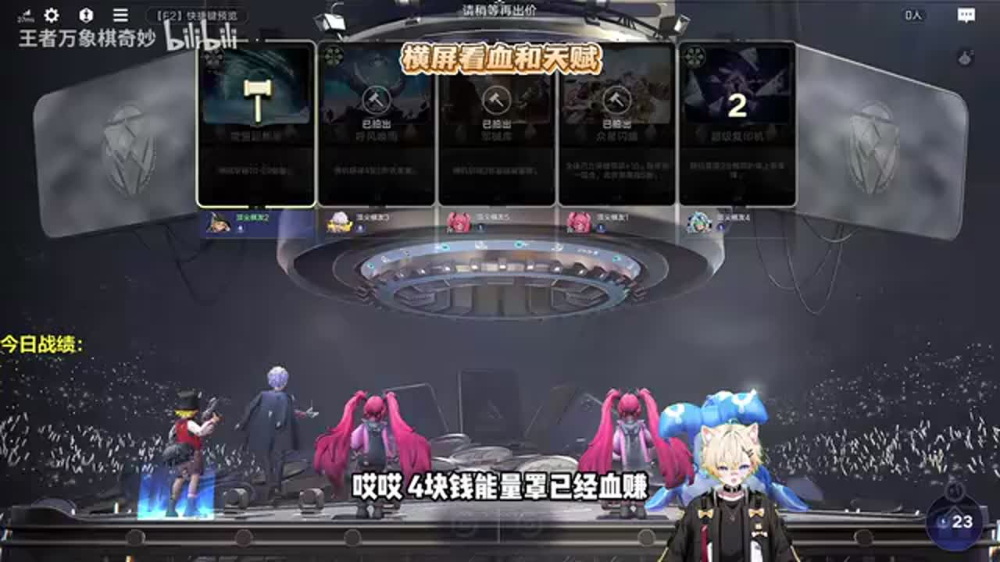
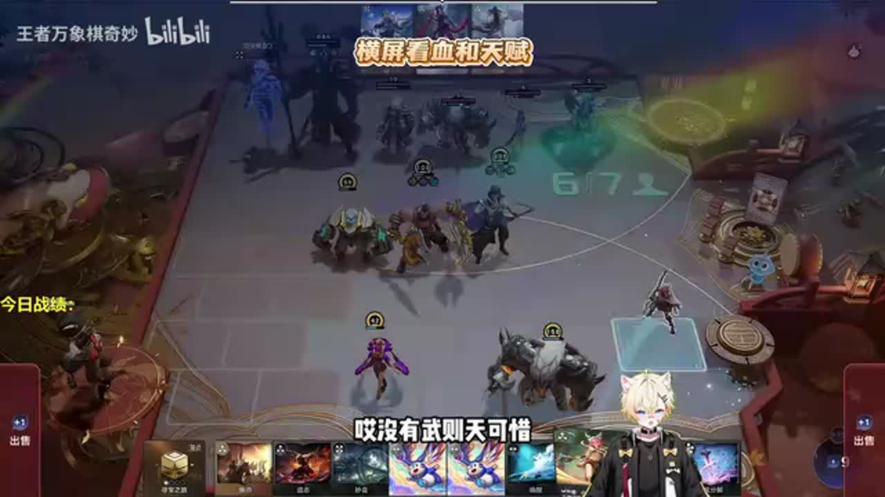
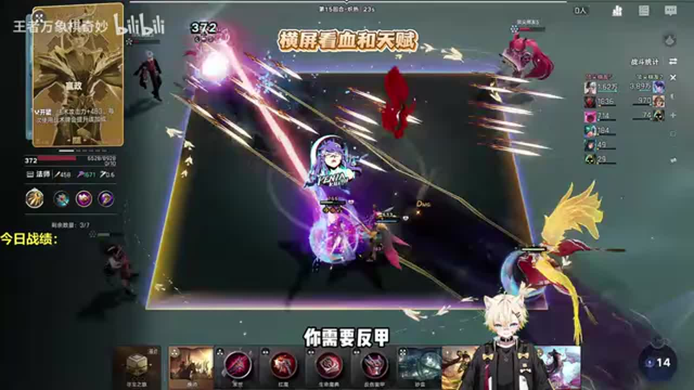

# 马克多彩古币无敌套路，10回合500级全程碾压

来源：https://www.bilibili.com/video/BV1f78y6eEfF/?p=1

分析状态：completed

完整文字稿：../../../raw/BV1f78y6eEfF_p1.md

## 02:21–03:09 利用低阶单位反复合成成长，再把阶数提高后的单位转到最终核心

- 事件 ID：BV1f78y6eEfF:p1:e001
- 场景：实战
- 时机：开局确定多彩古币路线时
- 背景（分析推断）：早期整备时讲解低阶成长再转核心的结构；画面不能确认完整人物路线，人物细节保留待核实。
- 学习目标（分析推断）：把快速成长的过渡单位与最终战斗核心分开考虑。
- 模板：growth-combo
- ASR 段落：[6, 7]

> 先把一阶变成五阶

## 05:14–05:44 四张三阶及以下牌触发寻宝，多轮寻宝累计后强化宝藏，奖励不只有等级也有牌与效果

- 事件 ID：BV1f78y6eEfF:p1:e002
- 场景：实战
- 时机：循环启动后解释马可技能时
- 背景（分析推断）：仅按本段清楚口述记录，七轮等版本数字不独立验证。
- 学习目标（分析推断）：理解操作循环的触发条件与奖励类型。
- 模板：mechanic-model
- ASR 段落：[12]

> 每打出四张三阶以下包括三阶的牌

## 08:32–09:41 孙尚香提供刷新，芈月觉醒帮助更快推进循环；低阶单位仍服务成长

- 事件 ID：BV1f78y6eEfF:p1:e003
- 场景：实战
- 时机：工具出现而需要延续刷牌时
- 背景（分析推断）：不记录抢关注、礼物或无理由买卖，人名同音误识保留原话。
- 学习目标（分析推断）：识别持续循环的刷新与成长工具。
- 模板：growth-combo
- ASR 段落：[18, 19]

> 香香给刷新很容易

## 10:10–10:44 先把强化宝石镜用给梦奇，保留当前工具成长链，最终角色可通过换帅再到位

- 事件 ID：BV1f78y6eEfF:p1:e004
- 场景：实战
- 时机：拿到宝石镜而想过早换吕布时
- 背景（分析推断）：具体换帅路线口述存在严重误识，不硬写全部人物顺序。
- 学习目标（分析推断）：避免为最终核心过早拆掉启动工具。
- 模板：resource-order
- ASR 段落：[21]

> 保时进是一定给蒙奇的

## 12:35–13:36 先确认程咬金觉醒再兑现工具收益，未觉醒少给一个币；画面字幕可确认币，原ASR误写保留。

- 事件 ID：BV1f78y6eEfF:p1:e005
- 场景：实战
- 时机：程咬金未觉醒导致少给资源时
- 背景（分析推断）：仅提取明确的漏收益复盘，不统计夸张伤害与聊天。
- 学习目标（分析推断）：在兑现工具收益前检查觉醒条件。
- 模板：combat-review
- ASR 段落：[25, 26]

> 程晓鑫觉醒吧

## 17:05–18:06 强化宝石镜可加速成长，已有足够装备时不再保留干将，更新工具取舍

- 事件 ID：BV1f78y6eEfF:p1:e006
- 场景：实战
- 时机：宝藏强化选项与手牌占用时
- 背景（分析推断）：原话部分不完整，四张效果牌的细节不据此编造通用优先级。
- 学习目标（分析推断）：根据已满足的功能减少无效工具占位。
- 模板：resource-order
- ASR 段落：[34, 35]

> 不缺装的

## 18:58–19:28 仍要比较价格与回报，能量超新星在合适报价有净收益，不能因富有乱花

- 事件 ID：BV1f78y6eEfF:p1:e007
- 场景：实战
- 时机：有钱但拍卖报价过高时
- 背景（分析推断）：例子一块四块仅本局报价，不作为固定购买上限。
- 学习目标（分析推断）：保持预算纪律并比较资源净收益。
- 模板：economy-budget
- ASR 段落：[38]

> 我们虽然有钱,但不是这样花的

## 20:25–20:56 后续选择两张宝藏卡，它们也可产出强化宝石镜，不必继续重复拿单张

- 事件 ID：BV1f78y6eEfF:p1:e008
- 场景：实战
- 时机：已经得到强化宝石镜后再次选宝藏时
- 背景（分析推断）：选择优先级在关键工具已获得后改变。
- 学习目标（分析推断）：识别一次解锁后后续奖励的边际价值。
- 模板：resource-order
- ASR 段落：[41]

> 只要咱们拿到一张这个强化宝石镜

## 22:43–23:15 六级锦囊和换新提供更多牌，选两张宝藏卡；暂缓会丢失手牌的动作

- 事件 ID：BV1f78y6eEfF:p1:e009
- 场景：实战
- 时机：六级宝藏变强但考虑拿腰带时
- 背景（分析推断）：具体卡名和丢牌规则未从模糊原话扩写，保留先别急的警示。
- 学习目标（分析推断）：在不可逆资源操作前确认手牌成本。
- 模板：resource-order
- ASR 段落：[46]

> 你拿了你卡没了

## 24:27–24:59 关键高阶牌一张即可推进最终转型，此时传承未必有用；调整棋子位置便于快速合成

- 事件 ID：BV1f78y6eEfF:p1:e010
- 场景：实战
- 时机：低阶循环接近完成且准备换帅时
- 背景（分析推断）：具体人物同音误识待画面，不声称所有套路都不需传承。
- 学习目标（分析推断）：按当前转型工具选择路径并简化操作。
- 模板：late-transition
- ASR 段落：[49]

> 传承就没有用

## 26:37–28:04 补反甲等生存装备，并检查是否秒错目标，不能只看核心等级足够高；反甲由画面字幕确认，原ASR保留。

- 事件 ID：BV1f78y6eEfF:p1:e011
- 场景：实战
- 时机：转海月后战斗表现不如预期时
- 背景（分析推断）：多讲者互相指出问题，不把后续故意输的说辞作为已证实原因。
- 学习目标（分析推断）：从接敌目标和配装查找高等级仍输的原因。
- 模板：combat-review
- ASR 段落：[53, 54]

> 你秒错人了

## 31:51–32:26 强化宝石镜出现早晚与姬小满能否提供额外经济会改变循环速度

- 事件 ID：BV1f78y6eEfF:p1:e012
- 场景：实战
- 时机：总结本局宝石镜来得晚与禁姬小满时
- 背景（分析推断）：十回合999和一百两百收入为宣传或反事实估计，不统计为实际验证。
- 学习目标（分析推断）：区分路线机制与来牌、禁用造成的速度差异。
- 模板：mechanic-model
- ASR 段落：[63, 64]

> 如果有击小满无敌了

## 待核实与局限

- ASR质量明显较低，多处重复字符或口号，人物与操作细节严重误识；本次按用户要求不修正。
- 第5、9、24、28、33、36、42、52等重复段及其余无明确理由操作不纳入教学事件。
- 多个说话者来回交流，无法可靠逐句分配讲者，按视频来源作者统计不作额外作者计数。
- 高等级输局后故意输的说辞、一定999等宣传不作为事实验证；仅保留能追踪到原话与画面的学习点。
- 玉环与觉醒资源的句子无法确认动作和目标，已排除，不据其他视频补全本句。
