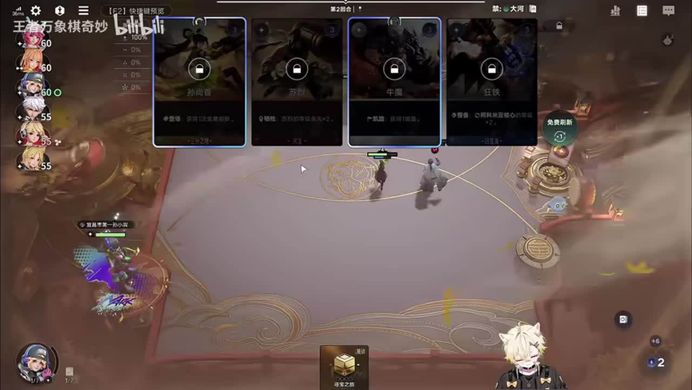
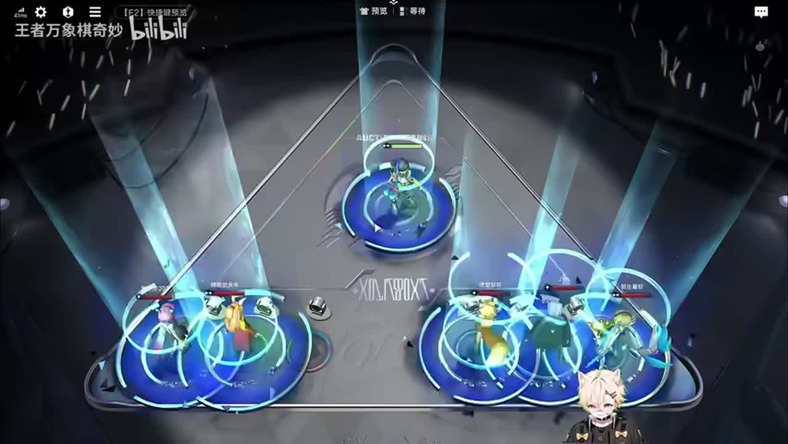
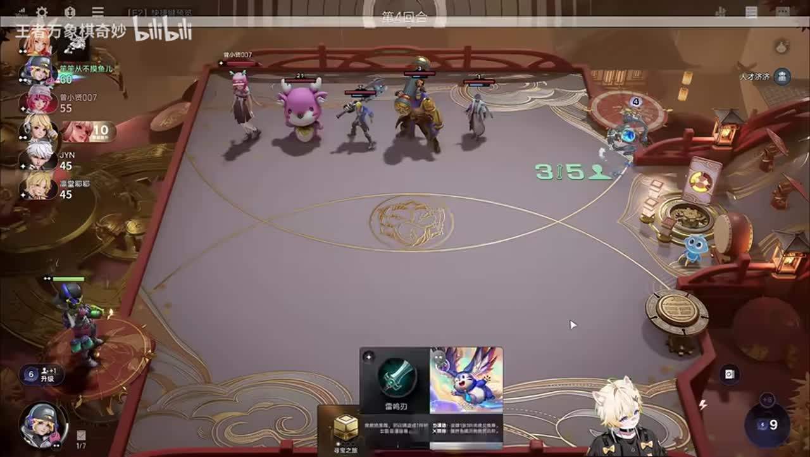
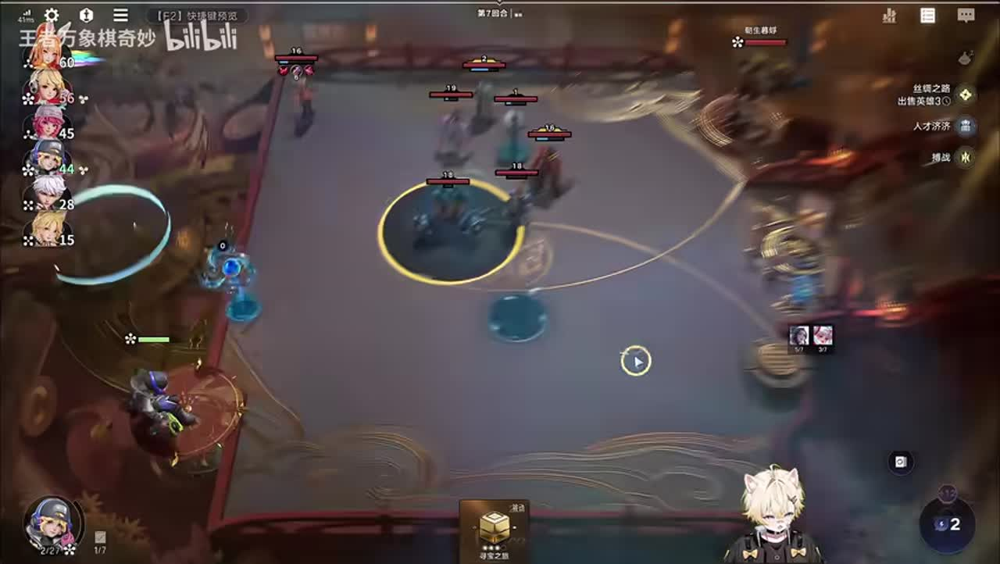
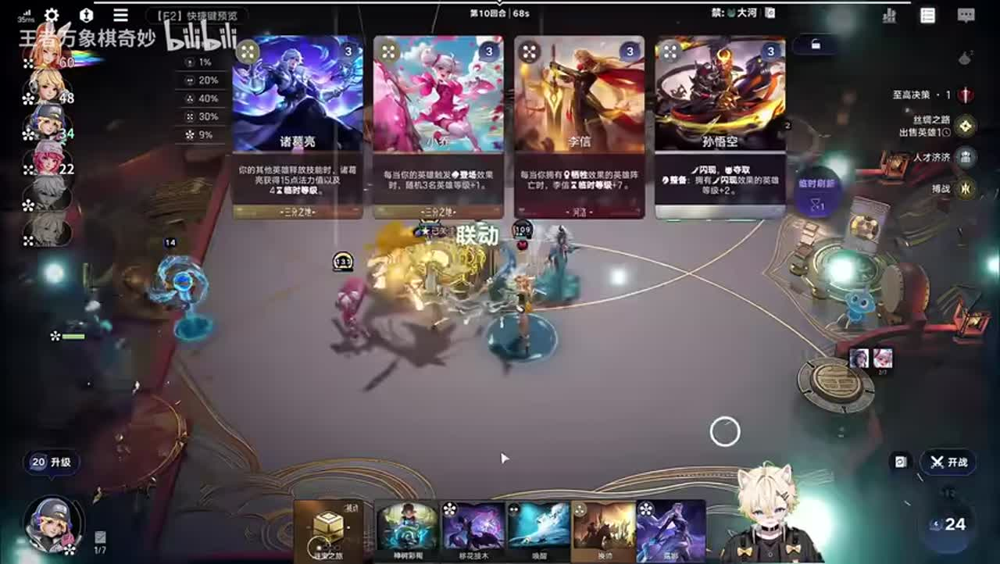
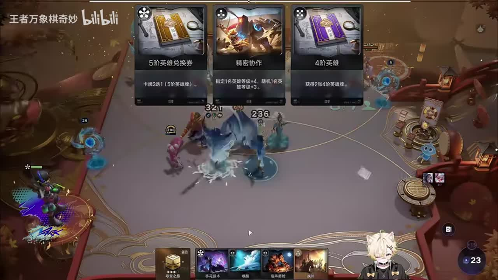
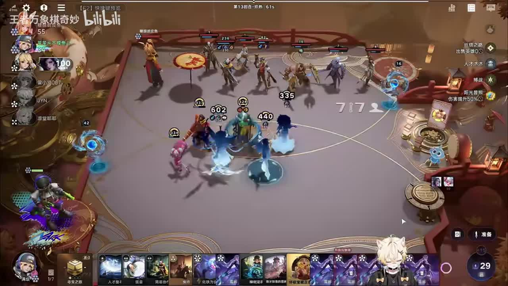

# 马可15回合999姜子牙手里100块花不完

来源：https://www.bilibili.com/video/BV11Stp6LE8u/?p=1

分析状态：completed

完整文字稿：../../../raw/BV11Stp6LE8u_p1.md

## 01:41–02:10 在刷掉所需牌之前解释收牌机制，提醒漏牌会影响后续刷新

- 事件 ID：BV11Stp6LE8u:p1:e001
- 场景：实战
- 时机：刷新商店前，有希望保留的英雄尚未买下时
- 背景（分析推断）：讲者举孙尚香、苏烈和狂铁为例，称本轮不买就会影响随后刷新。他给出的持续次数与后文不一致，本条只记录教学触发与解释方式。
- 学习目标（分析推断）：刷新前识别哪些牌值得先保留，并意识到一次漏牌可能影响接下来找牌；准确规则仍待核实。
- 模板：mechanic-model
- ASR 段落：[3]

> 你想要的卡就是它会,你得买下来,就比如你像这个苏烈和狂铁,我只要这一轮没有买我给它刷走

## 02:13–03:04 将人才济济与三分射、三分姜子牙关联，结合能否获得蔡文姬再决定转入三分

- 事件 ID：BV11Stp6LE8u:p1:e002
- 场景：实战
- 时机：人才济济出现后，需要把原定开局方向调整为能利用天赋的路线
- 背景（分析推断）：前段末尾出现人才济济，讲者随后讨论三分路线并关注拍卖蔡文姬。属于天赋与来牌同时限定的路线判断，非保证任何人才济济都适合同一阵容。
- 学习目标（分析推断）：把已选天赋与可获得的核心组件联起来，保留多条可兑现的方向。
- 模板：opening-plan
- ASR 段落：[4]

> 咱们这轮拍卖看能不能拿个蔡文姬吧如果能拿到蔡文姬我们就去玩一下三分

## 03:17–03:55 在下一次操作前重复提醒不要漏掉所需卡

- 事件 ID：BV11Stp6LE8u:p1:e003
- 场景：实战
- 时机：再次回应漏牌问题，玩家还在刷新和抢拍之间操作时
- 背景（分析推断）：这次提醒重复前面的收牌说明，但讲者改为连续三次刷新不来，与先前次数存在差异。保留重复教学事件而不确认具体数字。
- 学习目标（分析推断）：把机制提醒转成刷新前的检查习惯，避免知道机制却在操作时遗漏。
- 模板：mechanic-model
- ASR 段落：[5]

> 对呀,所以不能漏卡呀,你一漏卡,他连着三次刷新他就不会再给你这张卡了所以不能漏卡呀

## 03:17–04:25 用经济来源比较阵营路线：倒转需要能回收钱的发动机，不是任意阵营都能照搬

- 事件 ID：BV11Stp6LE8u:p1:e004
- 场景：实战
- 时机：有人提出日落海倒转，讲者需要解释为什么选择三分经济路线
- 背景（分析推断）：讲者先说日落海不给钱，再用三分曹操触发甄姬举例说明能赚起来。此为视频当时机制和来牌下的比较，不改写成当前版本通用规则。
- 学习目标（分析推断）：检查一条循环是否能持续回收资源，而不是只看阵容名称或成长结果。
- 模板：growth-combo
- ASR 段落：[5, 6]

> 你像三分倒转,曹操是能触发甄姬,甄姬是能给钱的,他是能赚起来,日落海又不给钱。

## 05:37–06:14 用实际击杀解释败局里的稳血收益

- 事件 ID：BV11Stp6LE8u:p1:e005
- 场景：实战
- 时机：本轮难以战胜对手，但仍能击杀部分单位时
- 背景（分析推断）：讲者先确认本轮打不过，仍希望杀掉牛和李元芳，随后解释因此少掉血。两滴和四滴说法先后修正，具体数值不由截图计算。
- 学习目标（分析推断）：在无法取胜的回合仍争取减少损失，理解胜负之外的局部运营价值。
- 模板：combat-review
- ASR 段落：[9]

> 这一轮是肯定打不过的只要能杀个牛也行能不能再杀个李元芳

## 07:28–08:28 顺着刚触发的古币讲清卖牌、古币、钱与买牌之间的经济循环

- 事件 ID：BV11Stp6LE8u:p1:e006
- 场景：实战
- 时机：刚拿到丝绸之路，古币开始不断出现时
- 背景（分析推断）：讲者说明卖四张卡产生古币，再在下一段逐步解释古币换钱、钱买卡、卖卡再产生古币。具体触发对象和历史数值只沿用视频原话，未验证到当前版本。
- 学习目标（分析推断）：把反复买卖理解为可持续的资源回路，识别每一环怎样支持下一环。
- 模板：growth-combo
- ASR 段落：[12, 13]

> 我一直卖卡,他一直给古币。我把古币再换成钱,钱再换成卡,卡再换成古币,古币再换成钱。

## 08:28–08:59 换下过渡棋子前先检查下一次曹操成长是否还值得吃到

- 事件 ID：BV11Stp6LE8u:p1:e007
- 场景：实战
- 时机：姜子牙入队后准备换下孙尚香，临近下一次成长收益时
- 背景（分析推断）：讲者先想让50多级的过渡棋子离场，随后自我修正为下一波吃一口曹操再走。当前循环成长已很快，不把这次延后当成固定回合规则。
- 学习目标（分析推断）：在替换棋子时比较立即腾位与多吃一次成长的机会成本。
- 模板：late-transition
- ASR 段落：[14]

> 不对,我应该让他下一波滚啦,下一波滚是对的,再吃一口曹操再滚是对的

## 09:31–10:15 解释竞价不只为自己拿牌，也可围绕对手发动机做有条件的阻断

- 事件 ID：BV11Stp6LE8u:p1:e008
- 场景：实战
- 时机：拍卖出现同行需要的小乔，而自己小乔已经觉醒时
- 背景（分析推断）：讲者已觉醒小乔，仍考虑顶价，因为对手没有小乔就难以倒转。后文也提醒继续竞价可能反过来让对手顶自己；不推广成无条件恶意竞价。
- 学习目标（分析推断）：理解竞价的对手收益和代价，辨认何时一张牌是对手的关键缺口。
- 模板：counter-target
- ASR 段落：[15, 16]

> 顶一下他,他就没小乔了,他没小乔他就裂开了,他没小乔他玩倒转他就死球了。

## 09:37–10:15 先完成经济核心觉醒，再考虑暂时无法兑现的露娜

- 事件 ID：BV11Stp6LE8u:p1:e009
- 场景：实战
- 时机：甄姬尚未觉醒，却有露娜可争抢时
- 背景（分析推断）：讲者明确先抢甄姬并完成觉醒，指出没有小乔、甄姬未觉醒时露娜没有用。这是发动机尚未完成阶段的优先级。
- 学习目标（分析推断）：按发动条件排列核心与放大器，避免先拿一个当前无法发挥作用的组件。
- 模板：resource-order
- ASR 段落：[16]

> 直接抢甄姬,不要露娜,露娜没有用。露娜对于我们来说一点用没有,先把甄姬觉醒了再说吧。

## 10:16–11:13 优先能继续补牌和产生古币的功能，古币换牌时偏向三费以下的低费牌

- 事件 ID：BV11Stp6LE8u:p1:e010
- 场景：实战
- 时机：古币和功能牌不断进入循环，需判断换牌的费用与收益时
- 背景（分析推断）：讲者讨论梦奇、武则天、三分与登场牌的作用，并明确不喜欢古币换到李信，倾向三费以下。低费牌为何更合适需结合马可触发和经济回路理解，不能推广为低费牌永远好。
- 学习目标（分析推断）：用一张牌能补回多少资源、能否继续触发循环判断购买与兑换价值。
- 模板：resource-order
- ASR 段落：[17, 18]

> 但是他换成李信不太好,换成弄三费以下的比较好。

## 11:14–12:13 把等级成长慢归因于姜子牙尚未觉醒，先解决觉醒瓶颈

- 事件 ID：BV11Stp6LE8u:p1:e011
- 场景：实战
- 时机：姜子牙等级成长慢于预期，需要诊断卡住在哪里时
- 背景（分析推断）：讲者观察到姜子牙仅45级，随后说明主要是没觉醒，觉醒后升级更快。具体等级增长公式没有在此段完整讲解。
- 学习目标（分析推断）：当成长不如预期时找发动条件的缺口，而不是只继续投入同样的操作。
- 模板：mechanic-model
- ASR 段落：[19, 20]

> 这姜子牙主要是没觉醒。他没觉醒升级有点慢等他觉醒了升级就快了

## 13:52–14:21 再次按补牌与古币收益筛选循环材料，说明庄周、武则天等牌为什么可买

- 事件 ID：BV11Stp6LE8u:p1:e012
- 场景：实战
- 时机：循环已运行，但不断拿到昂贵英雄影响买牌节奏时
- 背景（分析推断）：讲者嫌花木兰等牌贵，希望来便宜的盾山；随后逐一说明庄周给两张牌、武则天给古币。是对当下循环缺口的材料选择，不是完整英雄强度排名。
- 学习目标（分析推断）：把‘买哪些牌’解释成具体资源收益，独立识别功能相近的替代材料。
- 模板：resource-order
- ASR 段落：[24]

> 庄周能给两张卡也可以拿,老夫子可以拿,老夫子一会打合成,露娜可以拿

## 14:22–15:22 在卡牌卡手时解释老夫子的补牌触发，把为何等待合成讲明白

- 事件 ID：BV11Stp6LE8u:p1:e013
- 场景：实战
- 时机：手里有两张老夫子，等待通过合成把补牌收益兑现时
- 背景（分析推断）：讲者先说两张老夫子要打合成才划算，下一段解释上场其他卡、打合成能给牌。ASR中‘打S合成’疑词保留，准确触发需对照画面和历史牌面。
- 学习目标（分析推断）：识别功能牌的触发前提，区分拿到牌与实际兑现收益。
- 模板：mechanic-model
- ASR 段落：[25, 26]

> 这个老头是你上场其他卡的时候打S合成他能给你一张卡

## 16:25–17:24 把宝石镜与露娜觉醒串起来解释复制循环，而不是只展示刷牌速度

- 事件 ID：BV11Stp6LE8u:p1:e014
- 场景：实战
- 时机：手里已有两张宝石镜，需要说明循环强度来自哪里时
- 背景（分析推断）：讲者拿两张宝石镜后复制露娜，明确说这套强在能反复觉醒露娜，并指出宝石镜留给露娜。没有将‘无限’解释为任何手牌下都能无条件成立。
- 学习目标（分析推断）：识别复制对象、保留材料与觉醒收益之间的关系，理解循环的核心组件。
- 模板：growth-combo
- ASR 段落：[29, 30]

> 为什么这套玩倒转厉害,这套能无限觉醒露娜。所以厉害

## 17:56–18:58 先讲清临时变化与真实英雄的区别，再说明把临时高等级转为实卡的用途

- 事件 ID：BV11Stp6LE8u:p1:e015
- 场景：实战
- 时机：成长循环已形成，准备把老虎的临时高等级转为长期战力时
- 背景（分析推断）：讲者计划让老虎通过备战获得高等级，再使用一张转换牌把假的变真的，承诺后面演示。牌名的准确写法待画面确认。
- 学习目标（分析推断）：理解临时收益的有效期和转化路径，在行动前准备需要的转换资源。
- 模板：late-transition
- ASR 段落：[32, 33]

> 老虎打一个备战直接999,然后化成一个真的。把一个假的能化成一个真的一会儿给你们演示一下

## 19:59–20:26 明确此时稀缺资源是时间，减少浪费操作机会

- 事件 ID：BV11Stp6LE8u:p1:e016
- 场景：实战
- 时机：经济已经越花越多，而操作时间开始成为瓶颈时
- 背景（分析推断）：讲者强调钱不断增加，随后说时间比什么都宝贵，并选择直接处理两张老夫子。适用前提是当前经济循环已经运行。
- 学习目标（分析推断）：随阶段重新判断稀缺资源，避免只盯着金币忽略有限操作时间。
- 模板：resource-order
- ASR 段落：[36]

> 现在时间是最宝贵的。现在时间比啥都宝贵

## 19:59–20:26 以当前能否吃到收益解释为什么选择阳光普照

- 事件 ID：BV11Stp6LE8u:p1:e017
- 场景：实战
- 时机：升级出现天赋选择，当前仍无法兑现重点照顾收益时
- 背景（分析推断）：讲者说重点照顾现在吃不上，改选阳光普照；本段没有完整列出受益对象，不能补猜具体站位条件。
- 学习目标（分析推断）：选择天赋前先核对当前兑现条件，而不只看名义收益。
- 模板：talent-fit
- ASR 段落：[36]

> 重点照顾现在吃不上,我直接阳光普照得了。

## 20:57–21:57 重复强调留两张露娜作下一轮复制材料，等两张宝石镜继续循环

- 事件 ID：BV11Stp6LE8u:p1:e018
- 场景：实战
- 时机：升级后的宝石镜复制循环可以一次给多张露娜，准备把卡全用掉时
- 背景（分析推断）：讲者得到六张露娜后明确留两张，等下一张宝石镜，再继续复制。本事件与前面机制解释相隔数分钟，记录为再次训练保留材料的独立教学。
- 学习目标（分析推断）：建立复制前检查和保留种子的习惯，避免一次打空关键手牌让循环中断。
- 模板：growth-combo
- ASR 段落：[38, 39]

> 我们留两个露娜兄弟们,留两个,留两个一会宝石镜来了的时候再打

## 22:58–24:01 兑现先前承诺的转换演示：把临时高等级转成海月实卡

- 事件 ID：BV11Stp6LE8u:p1:e019
- 场景：实战
- 时机：老虎已觉醒并获得高等级，转换路线终于可以实际兑现时
- 背景（分析推断）：前文解释假英雄变真的，42段保留备战并准备转换，43段实际得到约850级的海月。单次结果不意味着转换能保证获得海月。
- 学习目标（分析推断）：把前置机制与完整操作链相连接，识别资源准备、触发和兑现的顺序。
- 模板：late-transition
- ASR 段落：[42, 43]

> 直接变成一个海月兄弟们帅不帅直接变海月

## 25:03–26:00 按当前对手压力判断控制挂件是否必要，避免机械塞入固定辅助

- 事件 ID：BV11Stp6LE8u:p1:e020
- 场景：实战
- 时机：考虑补充钟馗等挂件，而讲者判断当前对手压力不高时
- 背景（分析推断）：讲者考虑太乙和钟馗，先判断对面不厉害，因此说不用钟馗；随后仍讨论其他可用挂件。具体对手阵容和威胁若看不清，不猜英雄克制。
- 学习目标（分析推断）：把辅助位当作针对需求，而不按固定名单无条件占位。
- 模板：counter-target
- ASR 段落：[46, 47]

> 对面厉害嘛,对面不厉害,不用挂钟馗。对面是不用挂钟馗的

## 27:36–28:06 解释不同商店等级改变卡池结构，五级刷的宝藏成长不能直接与三级刷比较

- 事件 ID：BV11Stp6LE8u:p1:e021
- 场景：实战
- 时机：展示高等级结果后，观众比较本局刷牌速度与其他马可路线时
- 背景（分析推断）：讲者明确本局阳光普照1.0、五级刷，区别于1.5和三级刷；认为五级高费卡较多，宝藏层数更慢。本条保留历史说法，不把绝对‘全是五费’泛化为卡池概率。
- 学习目标（分析推断）：比较套路结果时同时比较天赋与卡池阶段，认识更高商店等级存在经济触发的取舍。
- 模板：level-transition
- ASR 段落：[51]

> 五级刷全是五费卡,刷不了多少层的

## 待核实与局限

- 收牌机制的持续长度在101–131秒说后两次刷新，在197–235秒说连续三次刷新，在1227–1256秒又说三回合；保留原话矛盾，未确认准确次数和单位。
- ‘化铁围曲’等口语识别需通过对应牌面确认，不能直接把当前实体库名称改写到历史视频。
- 1286–1337秒ASR有长重复文本，排除无可确认教学语义的重复片段，保留原始ASR。
- 数值与玩法仅代表该视频时期；999结果不代表观众已经掌握或该套路胜率已验证。
