# 马可养999吕布乱杀一车999倒转

来源：https://www.bilibili.com/video/BV1Yrhe6wEPP/?p=1

分析状态：completed

完整文字稿：../../../raw/BV1Yrhe6wEPP_p1.md

## 00:00–01:01 希望取胜时上两人，互相掉一血换免费刷新也可接受

- 事件 ID：BV1Yrhe6wEPP:p1:e001
- 场景：实战
- 时机：首轮比场上人数控制胜负
- 背景（分析推断）：讲者观察对手单人开局并比较双方人员数量
- 学习目标（分析推断）：认识前期胜负与免费刷新的交换
- 模板：combat-review
- ASR 段落：[1, 2]

> 获得一次免费刷新

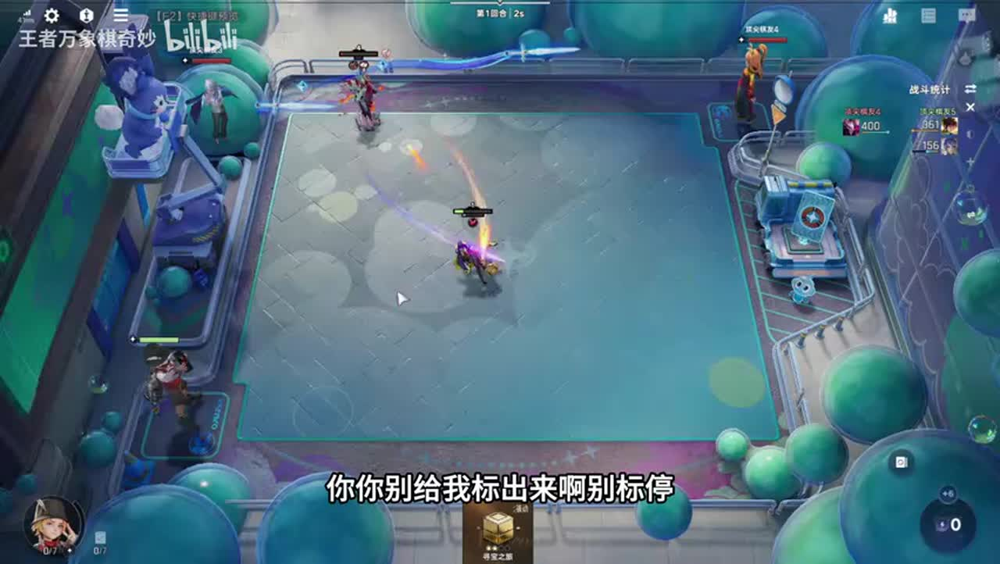

## 00:32–01:32 将贤士登门每轮给整备英雄的经济价值与给单卡天赋比较

- 事件 ID：BV1Yrhe6wEPP:p1:e002
- 场景：实战
- 时机：拿到贤士登门经济天赋
- 背景（分析推断）：马可依赖用牌与卖牌循环，此天赋匹配资源需求
- 学习目标（分析推断）：按棋手循环评价天赋收益而非只看品阶
- 模板：talent-fit
- ASR 段落：[2, 3]

> 一个回合给三块

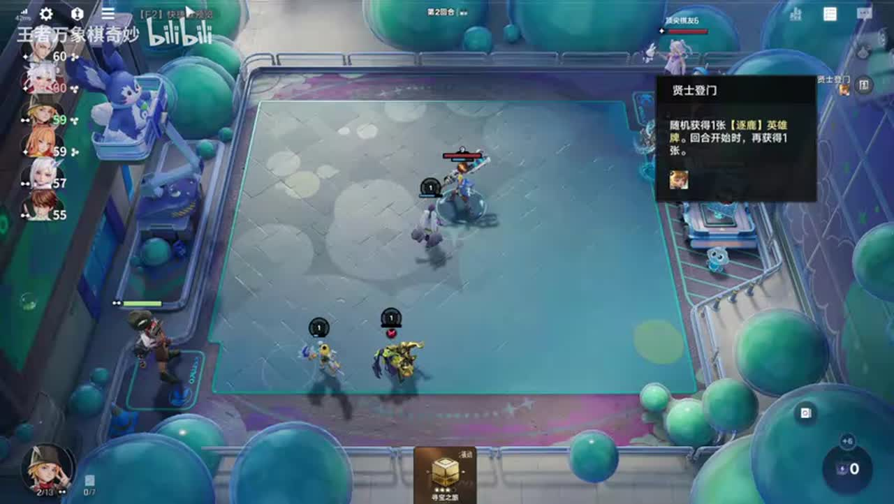

## 01:32–02:37 卖牌并尽早点准备以先掉血保持后三名

- 事件 ID：BV1Yrhe6wEPP:p1:e003
- 场景：实战
- 时机：准备争取后三名资源
- 背景（分析推断）：名次影响当前想要的资源，讲者在意其他人掉血速度
- 学习目标（分析推断）：识别连败计划所依赖的实时排名
- 模板：opening-plan
- ASR 段落：[4, 5]

> 谁掉血快谁是后三

## 03:09–03:40 不因来猪就养猪，先判断现有装备能否支持

- 事件 ID：BV1Yrhe6wEPP:p1:e004
- 场景：实战
- 时机：猪八戒到手但装备不适配
- 背景（分析推断）：当前装备被讲者认为不适合猪八戒
- 学习目标（分析推断）：把装备适配加入主核选择
- 模板：equipment-role
- ASR 段落：[7]

> 我的这个装备都不是猪的装备

## 07:36–08:10 避免合掉经济组件，合成选更多可用卡

- 事件 ID：BV1Yrhe6wEPP:p1:e005
- 场景：实战
- 时机：误合孟奇后复盘
- 背景（分析推断）：讲者承认误合孟奇并指出原本该选两张闪现
- 学习目标（分析推断）：识别合成收益与失去组件的成本
- 模板：combat-review
- ASR 段落：[13]

> 我应该拿两个闪现的

## 08:10–08:40 优先一块钱效果组件，暂不买两块钱牌

- 事件 ID：BV1Yrhe6wEPP:p1:e006
- 场景：实战
- 时机：搜牌预算紧张
- 背景（分析推断）：缺目标镜的局面下维持低成本循环
- 学习目标（分析推断）：按循环成本约束购买
- 模板：economy-budget
- ASR 段落：[14]

> 这种一块钱的买,两块钱的买不起

## 08:10–09:27 镜觉醒提升刷新成长，曹操只触发一次香香也够

- 事件 ID：BV1Yrhe6wEPP:p1:e007
- 场景：实战
- 时机：镜到手准备觉醒
- 背景（分析推断）：不同组件觉醒贡献不同，镜是成长核心而曹操只需启动
- 学习目标（分析推断）：区分必须觉醒的核心与够用的工具位
- 模板：growth-combo
- ASR 段落：[14, 15]

> 觉醒之后刷两张加两级

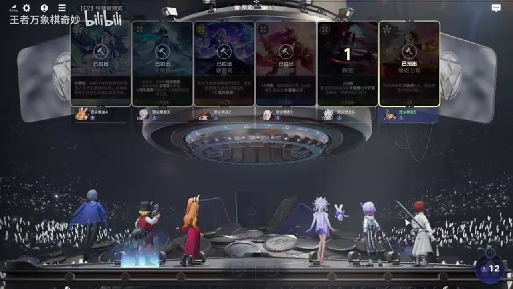

## 08:41–10:03 不缺少量刷新时卖曹操腾位，先让镜觉醒

- 事件 ID：BV1Yrhe6wEPP:p1:e008
- 场景：实战
- 时机：已有鲁班替代曹操功能
- 背景（分析推断）：循环组件与人口有限，曹操已非必要
- 学习目标（分析推断）：根据功能重叠腾出人口
- 模板：late-transition
- ASR 段落：[15, 16]

> 这个曹操没有用

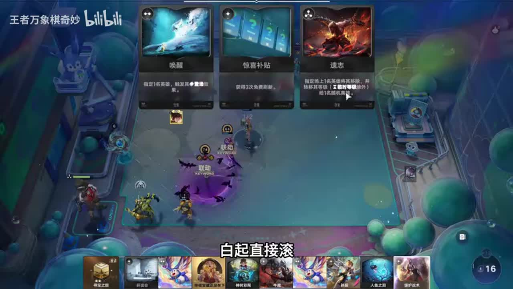

## 09:31–10:39 先找弈星再升级，香香更适合用孟奇开出

- 事件 ID：BV1Yrhe6wEPP:p1:e009
- 场景：实战
- 时机：升级前补弈星经验
- 背景（分析推断）：升级只差少量经验，可先利用组件提供的经验
- 学习目标（分析推断）：升级前使用可替代付费的经验来源
- 模板：resource-order
- ASR 段落：[16, 17]

> 先让我找一个异星

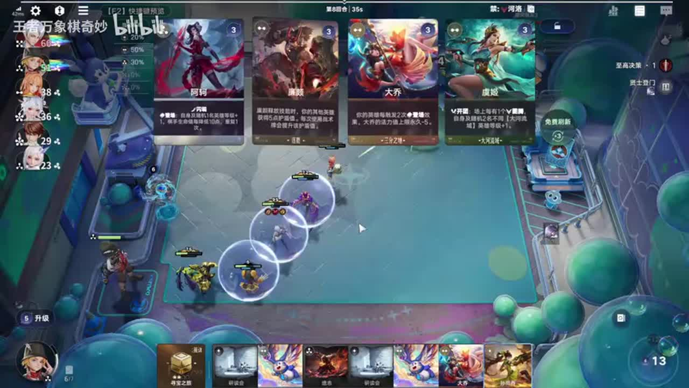

## 11:40–12:42 优先带加号可复制两张的宝石镜，而非任意升级

- 事件 ID：BV1Yrhe6wEPP:p1:e010
- 场景：实战
- 时机：宝藏升级目标确认
- 背景（分析推断）：普通复制收益不足，讲者在大宝藏中等待关键双倍组件
- 学习目标（分析推断）：辨别模块具体效果而不是同名就拿
- 模板：module-fit
- ASR 段落：[20, 21]

> 带加号的能复制两张

## 14:14–14:44 保留香香，后面移植等级并换帅转999吕布

- 事件 ID：BV1Yrhe6wEPP:p1:e011
- 场景：实战
- 时机：预留孙尚香用于终局转型
- 背景（分析推断）：镜负责前期成长，香香是跨英雄转移等级的桥梁
- 学习目标（分析推断）：提前保存转型桥梁而不是只保当前战力
- 模板：late-transition
- ASR 段落：[25]

> 转一个999的吕布

## 13:12–13:42 本应在四级多待一会，过早付费升级损失经济

- 事件 ID：BV1Yrhe6wEPP:p1:e012
- 场景：实战
- 时机：提前花三块升级的复盘
- 背景（分析推断）：讲者回顾刚才花三块升级，理想路径是留级做循环
- 学习目标（分析推断）：将等级节奏与循环收益共同考虑
- 模板：combat-review
- ASR 段落：[23]

> 亏了三块兄弟们

## 14:44–15:36 老夫子先合成再卖，合成奖励优先卡数多的

- 事件 ID：BV1Yrhe6wEPP:p1:e013
- 场景：实战
- 时机：连续买牌合成返卡
- 背景（分析推断）：出牌次数影响大招触发，整备两张优于单张奖励
- 学习目标（分析推断）：让合成奖励增加循环动作数
- 模板：resource-order
- ASR 段落：[26, 27]

> 两个整备是两张卡

## 15:10–15:36 先上白起再用效果卡以获取额外效果卡

- 事件 ID：BV1Yrhe6wEPP:p1:e014
- 场景：实战
- 时机：白起与效果卡联动
- 背景（分析推断）：当前循环追求更多牌数与刷新
- 学习目标（分析推断）：先建立返卡机制再消费触发资源
- 模板：growth-combo
- ASR 段落：[27]

> 他会再额外给你个效果卡

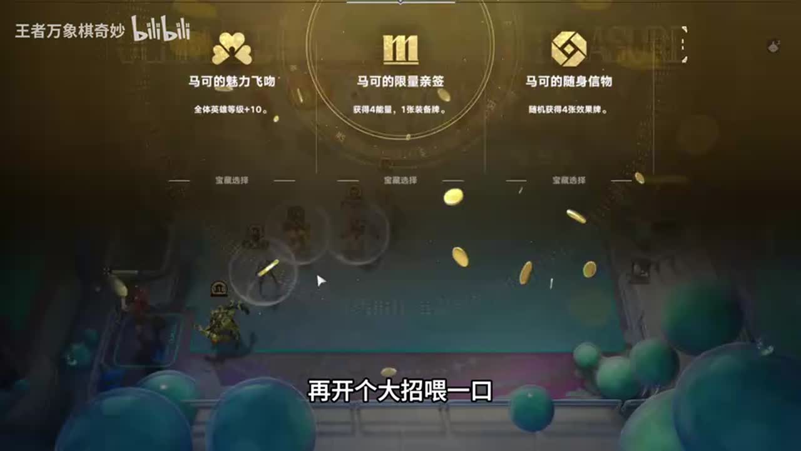

## 15:36–16:12 姜子牙会与其他组件分等级，不能只看增加等级能力

- 事件 ID：BV1Yrhe6wEPP:p1:e015
- 场景：实战
- 时机：考虑保留姜子牙时
- 背景（分析推断）：当前主核需要集中成长，额外英雄可能分摊资源
- 学习目标（分析推断）：考虑成长资源的分配对象
- 模板：position-binding
- ASR 段落：[28]

> 这两个人会分等级啊

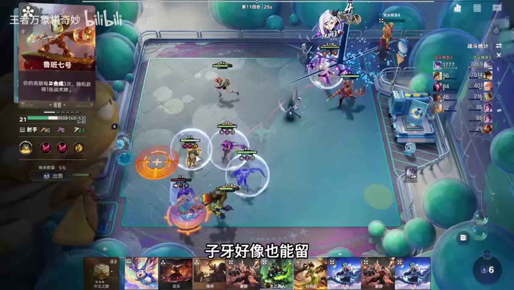

## 17:08–18:14 理想双倍宝石镜复制孟奇应钱越打越多，减少无效购买

- 事件 ID：BV1Yrhe6wEPP:p1:e016
- 场景：实战
- 时机：循环后钱越来越少
- 背景（分析推断）：关键双倍模块未到，实际余额下降与理想循环不符
- 学习目标（分析推断）：用余额方向识别经济循环是否成立
- 模板：combat-review
- ASR 段落：[31, 32]

> 越花越少不太对

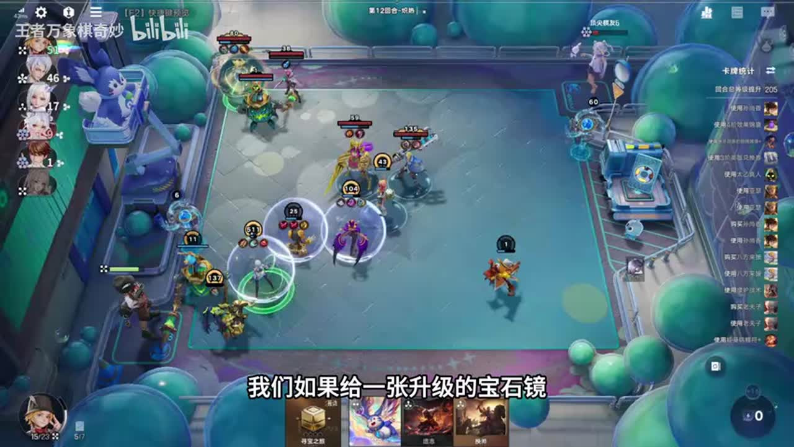

## 18:14–18:46 太乙觉醒后回手留用，不急着再上场消耗

- 事件 ID：BV1Yrhe6wEPP:p1:e017
- 场景：实战
- 时机：太乙即将觉醒时
- 背景（分析推断）：后期需要保护主核，手中太乙作为可调度资源
- 学习目标（分析推断）：为转型和终局保留防守组件
- 模板：resource-order
- ASR 段落：[33]

> 太乙直接觉醒回首

## 19:21–19:51 对手还有血量时继续当前成长，对手快淘汰再转

- 事件 ID：BV1Yrhe6wEPP:p1:e018
- 场景：实战
- 时机：外部血量仍足够时推迟转型
- 背景（分析推断）：当前还有机会多循环几轮，不急着消耗转型组件
- 学习目标（分析推断）：把外部存活窗口加入转型时机判断
- 模板：late-transition
- ASR 段落：[35]

> 外面只要有血量我们就不急着转阵容

## 20:52–21:21 钱越打越多说明当前循环成立，越花越少应检查购买和组件

- 事件 ID：BV1Yrhe6wEPP:p1:e019
- 场景：实战
- 时机：再次核对循环后的经济方向
- 背景（分析推断）：本轮连续操作后余额上升到三十块，讲者用它检查循环状态
- 学习目标（分析推断）：用可观察资源变化验证成长引擎
- 模板：combat-review
- ASR 段落：[38]

> 钱越打越多是对的

## 21:21–21:52 总等级足够后停止刷新，升级找吕布

- 事件 ID：BV1Yrhe6wEPP:p1:e020
- 场景：实战
- 时机：累计等级达到转型阈值
- 背景（分析推断）：镜及另一承载英雄的等级合计达到目标，讲者准备停止当前循环
- 学习目标（分析推断）：给成长阶段设置明确退出条件
- 模板：late-transition
- ASR 段落：[39]

> 他俩加钱如果有999我就直接升级去了

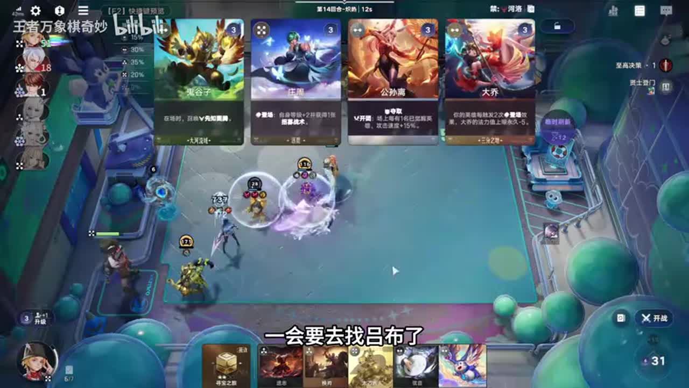

## 22:50–23:50 移植至香香后换帅吕布并配置装备，升级补金太乙

- 事件 ID：BV1Yrhe6wEPP:p1:e021
- 场景：实战
- 时机：总等级达到目标开始暴力转型
- 背景（分析推断）：讲者确认足够等级后清场转主核
- 学习目标（分析推断）：把前期增长资产转化为终局阵容
- 模板：growth-combo
- ASR 段落：[42, 43]

> 吕布丢上去对着换帅来一下

## 23:20–24:22 补高费人口满足重点照顾，观察吕布伤害加成

- 事件 ID：BV1Yrhe6wEPP:p1:e022
- 场景：实战
- 时机：重点照顾增伤条件核对
- 背景（分析推断）：999等级以外还有额外伤害来源，不能只比等级
- 学习目标（分析推断）：理解天赋条件与最终输出的关系
- 模板：talent-fit
- ASR 段落：[43, 44]

> 伤害加成111

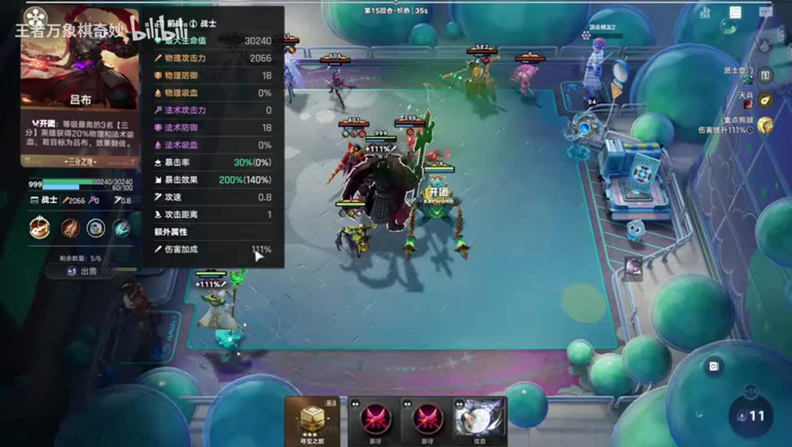

## 24:22–25:25 五费按多人计数满足条件；已999后刷新不再升等级可停止

- 事件 ID：BV1Yrhe6wEPP:p1:e023
- 场景：实战
- 时机：计算高费卡人数与停止刷新
- 背景（分析推断）：主核成长已封顶，仍有钱也不必持续刷
- 学习目标（分析推断）：按目标完成度停止无收益操作
- 模板：mechanic-model
- ASR 段落：[45, 46]

> 他是按人头算的

## 25:26–26:30 按纯战斗主核配输出装备，无需追对当前阵容无收益的觉醒词条

- 事件 ID：BV1Yrhe6wEPP:p1:e024
- 场景：实战
- 时机：主核战斗职责与觉醒取舍
- 背景（分析推断）：讲者说明相关吸血词条服务三分，而当前不依赖三分
- 学习目标（分析推断）：区别英雄战斗价值与阵营觉醒收益
- 模板：equipment-role
- ASR 段落：[47, 48]

> 你就把他当成一个打架的人就行了

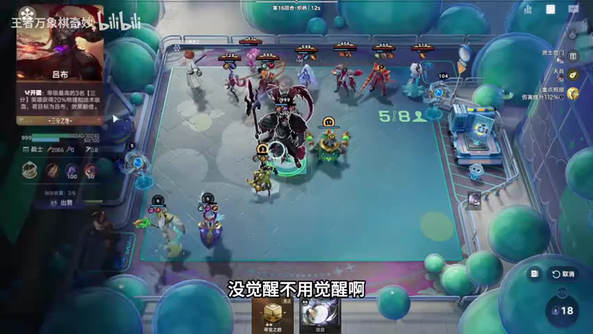

## 待核实与局限

- 不做ASR修正；贤士登门已由画面确认，宝石镜升级收益和数值为讲者版本说明。
- 大量找镜抱怨与单纯卖牌刷牌不统计。
- 后排重复刷新与一车999必胜的夸张表述不作为通用胜率或学习效果。
- 因缺双倍宝石镜，本局经济循环部分时间未达到理想状态。
